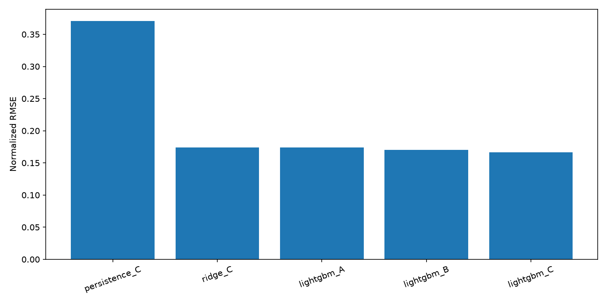
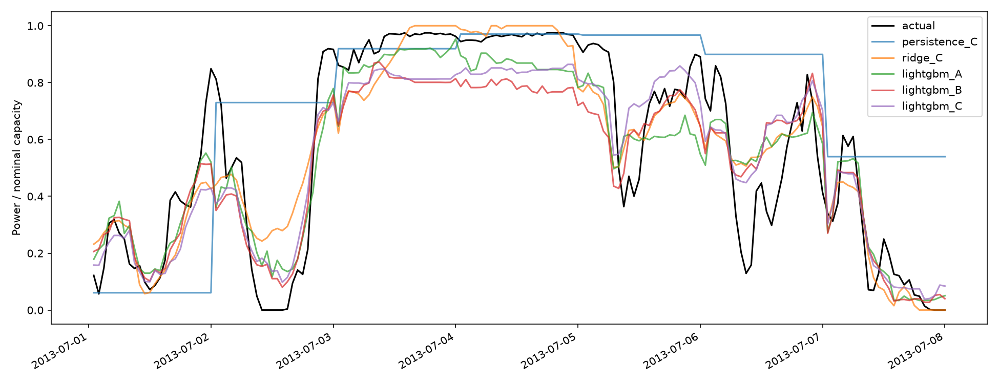
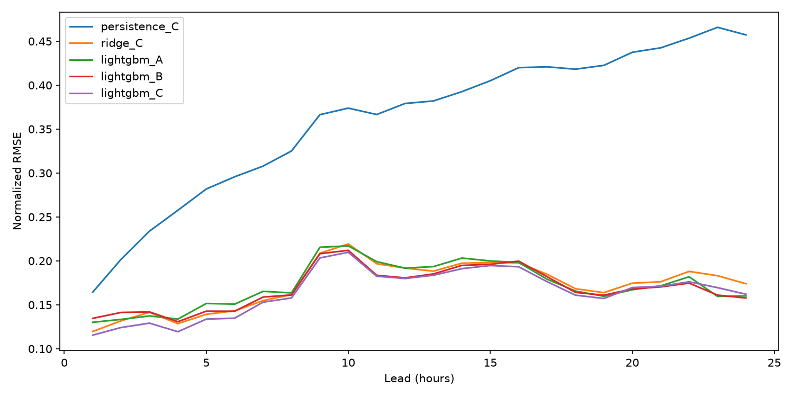

# Zone 5 实际实验报告

原始数据 17544 行，范围 2012-01-01 01:00:00 至 2014-01-01 00:00:00；重复 0，时间缺口 0，字段问题 {'power:missing': 6}。

训练 8736 个小时样本；验证 4344；独立测试 4392（183 个完整日）。

训练目标时间：['2012-01-03 01:00:00', '2013-01-01 00:00:00']；验证：['2013-01-01 01:00:00', '2013-07-01 00:00:00']；测试：2013-07-01 01:00:00 至 2013-12-31 00:00:00。

功率为容量归一化 0–1，因此 nMAE=MAE、nRMSE=RMSE；乘 100 可读为额定容量百分比。全部模型输出裁剪到 [0,1]，使用完全一致的测试起点及目标。

|模型|MAE|RMSE|n|
|---|---:|---:|---:|
|persistence_C|0.270946|0.370707|4392|
|ridge_C|0.128816|0.174206|4392|
|lightgbm_A|0.126679|0.173932|4392|
|lightgbm_B|0.124911|0.170456|4392|
|lightgbm_C|0.121532|0.166669|4392|

物理特征 B 相对 A 的 RMSE 差：-0.003476；历史功率 C 相对 B：-0.003787（负值为改善）。仅报告实测差异，不保证每个场站改善。

固定配置与 Ridge 超参数、LightGBM 早停仅使用训练/验证；测试只在模型保存之后评分。2013 年 12 月标签来自官方 solution15_W.csv，并非填补或合成。

时间为源文件无时区时间，不宣称 UTC。每日 00:00 起点及随后 1–24 小时 NWP 可用为竞赛回放假设；源包仅有有效时间，不能核实真正发布时间和到达时间。issued_at 保持 NULL。历史只允许 < origin，故 00:00 本身功率也不使用。

C 需要前 24 个完整历史小时；所有组共用相同完整日样本，最初两个起点及受缺失标签/历史影响的不完整日被排除。测试期过去已发生的真实功率可以作为后续预测起点历史，这模拟逐日滚动业务，不用于拟合模型。

本机无 Docker：已提供 postgres:18.6 Compose，但本次执行使用 Homebrew PostgreSQL 18.6 独立实例。未验证 Docker 路径。没有装机容量、现场日志或真实业务延迟，暂不能宣称生产级效果。