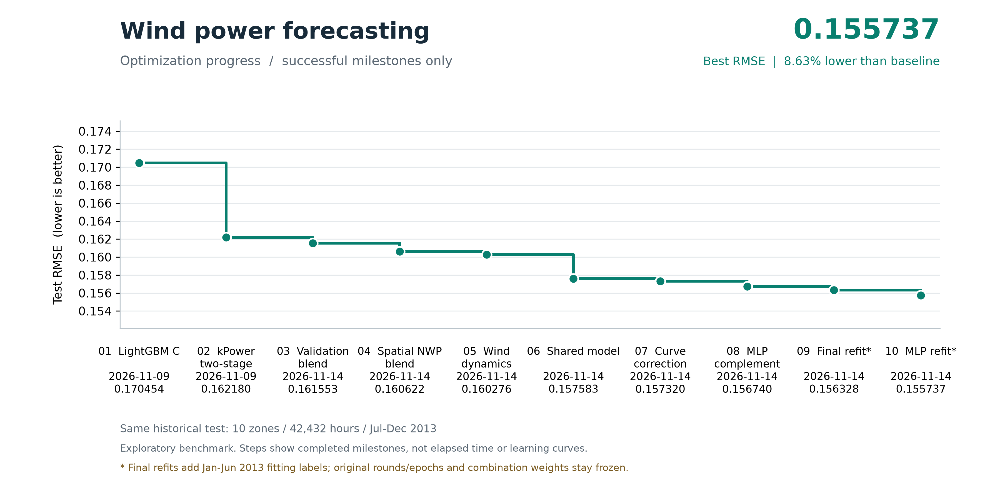

# 风电预测优化进展

更新：2026-11-14。只展示已实测且推进主指标 RMSE 的节点；失败或无可靠收益的方案停止推进。



<!-- progress-table:start -->
|进展|日期|十站测试 RMSE|相对前一节点降低|
|---|---|---:|---:|
|原 C 基线|2026-11-09|0.170454204|—|
|天气邻域 + OOF 跨站两层模型|2026-11-09|0.162180238|4.8541%|
|验证集全站共享凸融合|2026-11-14|0.161552864|0.3868%|
|十站原始风场 + 验证集融合|2026-11-14|0.160622327|0.5760%|
|跨站风速时变 + 验证集融合|2026-11-14|0.160275634|0.2158%|
|跨站共享模型 + 验证集融合|2026-11-14|0.157582752|1.6802%|
|场站曲线残差 + 验证集融合|2026-11-14|0.157320468|0.1664%|
|标准化 MLP + 验证集融合|2026-11-14|0.156740139|0.3689%|
|共享分支最终重拟合（扩展训练期）|2026-11-14|0.156327568|0.2632%|
|MLP 分支最终重拟合（冻结64轮）|2026-11-14|0.155737496|0.3775%|

累计 RMSE 降低 **8.63%**。各节点均为同一十站、42,432 小时、2013 年下半年历史测试集。
<!-- progress-table:end -->

横轴是成功节点顺序，不表示训练步数或实际耗时；图中不展示失败尝试。日期为可核实的实验记录日期，同一天的先后沿用实验记录顺序。

## 有效方法

**天气邻域与跨站 OOF 两层建模。** 用同一预测日内的风能邻域补充 NWP；把十站第一层预测作为第二层特征。第二层训练输入必须来自时间顺序 OOF，不能使用对应目标时段的真实功率。同样本消融支持天气邻域和跨站预测在当前设计下均有贡献。

**验证集凸融合。** 全站共用三个非负权重，和为一；只最小化验证集 MSE。C、天气邻域模型、完整两层模型的权重分别为 **0.122281198 / 0.084286243 / 0.793432559**。43,008 个验证小时拟合，权重保存后再加载测试集。

融合相对完整两层的 RMSE 差为 -0.000627374；2000 次七日连续日历块配对 95% 区间 **[-0.000963197, -0.000286049]**。同日所有站点共同重采样。MAE 从 0.115982666 小幅降至 0.115904742，但其差值区间跨零，不能声称 MAE 稳定改善。

**直接加入跨站原始风场，再做验证集融合。** 在既有 C、天气邻域和跨站预测特征之外，第二层追加十站同一预报时刻的 U100、V100、100m 风速，共 30 维。只读取预报字段，按预测起点与目标时刻双键匹配；训练样本仍使用原来的诚实 OOF 时间段，每站 6,576 小时。模型参数保持不变，验证集早停。

验证集拟合出的融合权重为：上一最优模型 **0.546497836**、新增风场模型 **0.453502164**；先冻结权重，后加载测试预测评分。独立风场模型 RMSE 为 0.160960701，融合后为 **0.160622327**，比上一最优再降低 **0.5760%**。

融合相对上一最优的 RMSE 差 **-0.000930537**，七日块配对 95% 区间 **[-0.001309387, -0.000500803]**；MAE 由 0.115904742 降到 **0.114890631**，差值区间 **[-0.001302545, -0.000715313]**。两者均支持当前历史测试期的改善。可复用要点：跨站第一层预测压缩了天气信息，保留原始空间风场可提供补充信息；当前证据支持的是这组特征及融合的整体方案。

**跨站风速时变作为互补模型。** 在前一方案的输入上，再加入十站 100m 风速在同一预报日内的 t−3、t−1、t+1、t+3 小时值，以及 t+1 减 t−1 的梯度，共 50 维。边界截在该预测起点的 24 小时窗口内，不能使用下一次起点的预报；仍不读取目标功率。完整预报日和边界检查已通过测试。

模型参数、训练样本和验证早停规则保持不变，仅用验证 MSE 拟合“前一最优 + 新时变模型”的凸融合。冻结权重为 **0.544211283 / 0.455788717**，43,008 个验证小时。测试 RMSE 从 0.160622327 降至 **0.160275634**（再降低 **0.2158%**）；MAE 从 0.114890631 降至 **0.114490104**。

相对前一最优，RMSE 差为 **-0.000346693**，七日块配对 95% 区间 **[-0.000612461, -0.000093068]**；MAE 差为 **-0.000400528**，区间 **[-0.000582459, -0.000216244]**。可复用要点：让邻站预报风速的变化模式作为补充输入，并用验证集确定与现有模型的融合比例。本次结论针对完整的特征加融合方案，不将融合收益单独归因于某个滞后量。

**跨站共享模型与各站模型互补。** 保留前一最优的全部特征，将十站相同 OOF 时间段训练样本合并为 **65,760 小时**，追加场站编号 `farm` 并作为类别特征，训练一个共享 LightGBM。固定 `num_leaves=31`、`min_child_samples=80`、最多 800 轮，其他设置沿用原配置；验证早停选择 **709 轮**。未使用跨站未来实测功率。

再用 43,008 个验证小时拟合共享模型与前一最优的凸融合：前一最优权重 **0.587095964**，共享模型 **0.412904036**。冻结后，同样 42,432 个测试小时的 RMSE 为 **0.157582752**，比前一最优再降低 **1.6802%**；MAE 为 **0.112679860**。

相对前一最优，RMSE 差 **-0.002692882**，七日块配对 95% 区间 **[-0.004129755, -0.001617600]**；MAE 差 **-0.001810244**，区间 **[-0.002510629, -0.001168028]**。可复用要点：保留各站专属模型，同时引入带场站类别的共享模型，用验证集确定组合比例。本轮同时改变了训练组织与树容量，证据支持整个配方，不将收益只归因于合并样本。

**场站经验曲线 + 共享残差模型，作为小权重补充。** 各站仅用完整 2012 年训练集，以 100m 预报风速和归一化功率拟合单调递增的 isotonic 经验响应曲线，输出限制 0—1，超出训练风速范围时取端点值。它是经验响应，不是厂家风机曲线。共享 LightGBM 在原 OOF 时间段的 **65,760 小时**上学习“实际功率减经验曲线值”，并把曲线值作为额外特征；类别仍为场站编号。31 叶、min_child_samples=80、最多 800 轮不变，验证残差 MSE 早停选择 **772 轮**。

最终预测加回曲线值再裁剪，并仅用验证集确定与前一最优的融合权重：前一最优 **0.873861511**、曲线残差模型 **0.126138489**。同样 42,432 个测试小时的 RMSE 达到 **0.157320468**，再降低 **0.1664%**；MAE 为 **0.112525922**。

相对前一最优，RMSE 差 **-0.000262284**，七日块配对 95% 区间 **[-0.000429680, -0.000103550]**；MAE 差 **-0.000153938**，区间 **[-0.000259440, -0.000045224]**。可复用要点：用训练期学到的各站经验曲线表达站点响应，再将共享残差模型以验证集确定的小权重加入现有组合。有效节点对应完整组合，未证明曲线或残差单独贡献。

**标准化 MLP 作为树模型的互补分支。** 沿用既有 122 项输入，追加十站固定独热编码，形成 **132 维**输入。StandardScaler 仅拟合原 OOF 训练期的 **65,760 小时**；MLP 固定隐藏层 `(128,64)`、ReLU、`alpha=0.1`、批量 512、学习率 0.001、最多 200 轮、随机种子 42。内部早停使用原训练期内 15% 随机留出，不使用 2013 年标签更新新网络。实际训练 **80 轮**，内部验证最高分出现在第 **64 轮**。输出裁剪到 0—1。

再用 43,008 个验证小时确定凸融合权重：前一最优 **0.827630628**、MLP **0.172369372**。相同 42,432 个历史测试小时上，RMSE 为 **0.156740139**，相对前一最优再降低 **0.3689%**；MAE 为 **0.111645608**。

RMSE 差 **-0.000580329**，七日块配对 95% 区间 **[-0.001119223, -0.000046356]**；MAE 差 **-0.000880314**，区间 **[-0.001307394, -0.000465185]**。可复用要点：标准化后的平滑神经网络可以以验证集确定的小权重补充树模型；本次有效的是整个组合，不能据此声称单独 MLP 更强。

**冻结后最终重拟合共享分支（训练协议变化）。** 先保留上述 2012 年训练、2013 上半年验证的模型选择结果；冻结各站第一层原选轮数、共享模型 **709 轮**、全部组合系数，再加入原验证期的过去标签做最终拟合。本节点只替换共享分支，其他分支及其原预测保持冻结。

所有新增拟合标签严格早于首个测试起点 **2013-07-01 00:00**，最晚标签为 **2013-06-30 23:00**。扩展期重新生成时间顺序 OOF，**158 个块**逐块核实训练标签早于预测块起点；共享层有效训练样本由 **65,760** 增至 **106,310**（受跨站交集与缺失筛选影响）。共享分支在当前组合中的原系数保持 **0.298626465**，由既有三层融合系数相乘得到，未重新选择。

组合预测按 `原组合 + 固定系数 × (新共享预测 − 原共享预测)` 替换，完全相同的 42,432 个测试小时上，RMSE **0.156740139 → 0.156327568**（再降低 **0.2632%**），MAE **0.111645608 → 0.111112534**。RMSE 差 **-0.000412571**，七日块配对 95% 区间 **[-0.000778241, -0.000025046]**；MAE 差 **-0.000533074**，区间 **[-0.000830152, -0.000239575]**。

本节点的收益对应扩大过去数据覆盖并最终重拟合的完整配方，不能作为相同训练量下的算法消融。**原验证期已参与该分支最终训练，不再是这个重拟合分支的独立验证集。** 后续方案须先在保留的原训练/验证选择路径上决定参数，再冻结并按明确的最终重拟合协议评价；禁止用最终重拟合后的验证期训练内预测继续调参。

**冻结 MLP 最佳轮数后最终重拟合。** 保留前一节点已更新的共享分支，只替换原 MLP。沿用隐藏层 `(128,64)`、ReLU、正则 0.1、批量 512、学习率 0.001、种子 42；固定原内部验证最高分对应的 **64 轮**。关闭内部留出与重新选轮，在 **106,310 个扩展 OOF 样本**上拟合新的 StandardScaler 和 MLP。

第一层直接复用上一节点的冻结重拟合版本，训练 OOF 仍逐块重建并核验 **158 个块**的标签可用性；最后标签严格止于 **2013-06-30 23:00**。MLP 原组合系数 **0.172369372** 不变，替换公式为 `前一组合 + 固定系数 × (新MLP预测 − 原MLP预测)`，未以测试集选择轮数或权重。

同样 42,432 个测试小时，RMSE **0.156327568 → 0.155737496**（再降低 **0.3775%**）；差值 **-0.000590072**，七日块配对 95% 区间 **[-0.001098188, -0.000025161]**。MAE 为 **0.111108339**，差值仅 -0.000004196，区间 **[-0.000446392, 0.000418953]**，没有证据支持 MAE 稳定改善。

本节点同样把原验证期标签用于最终拟合，属于扩大过去数据覆盖后的完整配方；不能再用该分支在旧验证期的训练内预测调参。原 2012 训练/2013 上半年验证的选择路径与旧模型仍保留，后续必须先选择、后冻结、再执行独立的最终重拟合。

这是已报告历史测试集上的探索性评价；既有第一层和基模型已复用验证集做早停。NWP 实际发布时间未知，沿用原竞赛回放假设。区间不涵盖重训或新年份的不确定性。

## 后续更新

每次优化完成后核实同样本指标，仅将确认改善 RMSE 的节点加入 `optimization-progress.json`，然后运行：

```sh
python scripts/plot_optimization_progress.py
```

也可用该脚本的 `--add-result` 入口登记结果；未改善会直接放弃，不进入进展图。有配对区间时，区间上界必须小于零。原始实验证据保留用于核对，不继续投入失败方案。

图、CSV 明细和本笔记同步更新到 Obsidian。精确数值直接从实验输出读取，避免手写维护导致漂移。

[消融证据](../artifacts/kpower_ablation/ablation_20261114_v1/report.md) · [融合证据](../artifacts/kpower_ablation/ablation_20261114_v1/validation_blend/report.md) · [空间风场证据](../artifacts/kpower_ablation/ablation_20261114_v1/spatial_nwp_v1/report.md) · [风场时变证据](../artifacts/kpower_ablation/ablation_20261114_v1/temporal_nwp_v1/report.md) · [共享模型证据](../artifacts/kpower_ablation/ablation_20261114_v1/shared_model_v1/report.md) · [经验曲线残差证据](../artifacts/kpower_ablation/ablation_20261114_v1/curve_residual_v1/report.md) · [MLP 融合证据](../artifacts/kpower_ablation/ablation_20261114_v1/mlp_shared_v1/report.md) · [共享最终重拟合证据](../artifacts/kpower_ablation/ablation_20261114_v1/shared_final_refit_v1/report.md) · [MLP 最终重拟合证据](../artifacts/kpower_ablation/ablation_20261114_v1/mlp_final_refit_v1/report.md) · [进展明细](figures/optimization-progress.csv)
