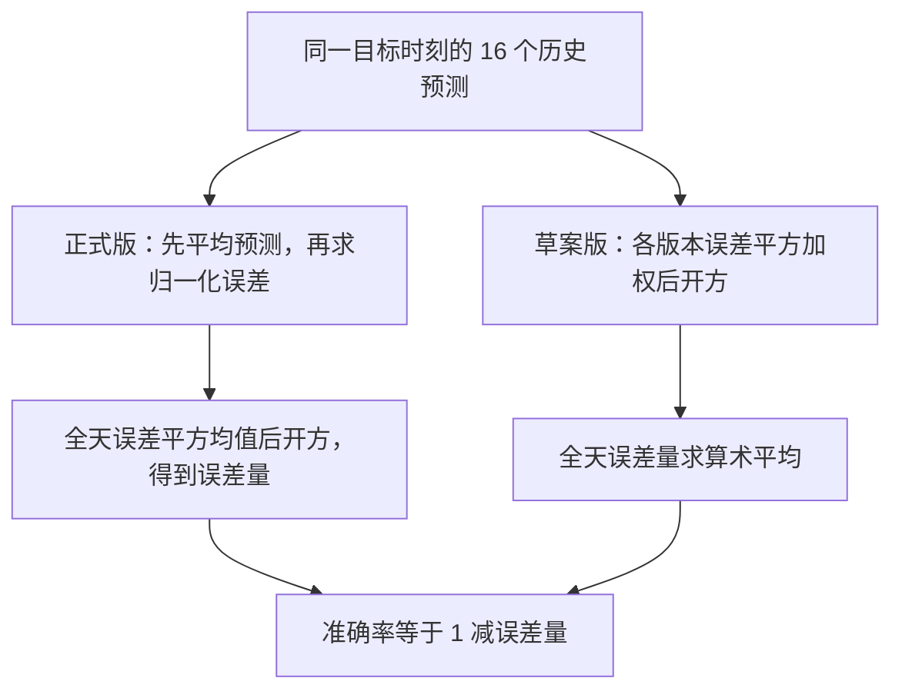

# 广西风电功率预测考核政策与训练评估适配

- **所属周次：**2026-W47（11 月 16—22 日）
- **资料核验日期：**2026 年 11 月 21 日
- **工作性质：**政策研究、公式核验与工程适配设计
- **适用对象：**广西风电功率预测项目；文中的风电阈值不适用于光伏电站。

**阅读入口：**[本周进展概览](00_本周总览.md) · [项目文档索引](../../README.md)

## 摘要

本报告核查广西风电日前 D+1 与超短期功率预测的报送要求、准确率公式、考核电量折算及其对训练数据的约束，并对照当前项目的小时级公开数据流程，提出可执行的适配顺序。

目前已核实的正式公开依据为 2024 年修订通知及 2025 年公布的南方区域“两个细则”整合修订版。风电日前准确率门槛为 **60%**，超短期为 **65%**；广西附表中的日前和超短期考核系数均为 **2**。正式指标按每个时刻的参考功率与 20% 当月装机容量的较大值归一化，不能直接用通常的容量归一化 RMSE 替代。[^s1][^s2]

正式版超短期指标对同一目标时刻的 16 次历史预测先求平均，再计算每日准确率。2026 年 8 月征求意见稿则拟分别计算各提前量误差，先在每个目标时刻求加权均方根，再对全天求平均，并拟将日前、超短期门槛提高至 65%、75%。本轮未找到该草案后续正式印发实施的官方文件，故将其单列为拟议规则。[^s4]

当前仓库基于 GEFCom2014-Wind 的小时级、归一化功率任务，尚不能直接给出广西实际考核成绩。后续工作的重点是补齐真实 15 分钟数据、发布与到达时间、容量和运行状态，建立版本化评价器，并以调度侧明细核对豁免、缺报及日到月归并。本文中的数值算例均为说明公式而构造，不是新增场站实验结果。

## 目录

1. [研究范围与证据使用原则](#1-研究范围与证据使用原则)
2. [政策依据与版本状态](#2-政策依据与版本状态)
3. [预测任务与报送要求](#3-预测任务与报送要求)
4. [正式版准确率公式](#4-正式版准确率公式)
5. [考核电量与金额](#5-考核电量与金额)
6. [豁免缺失与数据质量](#6-豁免缺失与数据质量)
7. [2026-年征求意见稿的变化](#7-2026-年征求意见稿的变化)
8. [指标对训练目标的影响](#8-指标对训练目标的影响)
9. [当前项目与广西业务的差距](#9-当前项目与广西业务的差距)
10. [数据契约与评价器设计](#10-数据契约与评价器设计)
11. [实施顺序与验收标准](#11-实施顺序与验收标准)
12. [结论与待核对事项](#12-结论与待核对事项)
13. [参考资料与仓库证据](#13-参考资料与仓库证据)

## 1. 研究范围与证据使用原则

### 1.1 研究问题

本报告回答以下问题：

1. 广西风电日前与超短期预测应在何时提交，覆盖哪些运行时刻？
2. 准确率如何计算，分母、样本数和预测版本如何选择？
3. 准确率或上报率不达标时，考核电量如何折算？
4. 哪些时段可以申请不纳入统计，哪些计算细节仍需现场规则确认？
5. 当前公开数据实验与真实考核有哪些差距，应如何调整训练和验证流程？

报告以风电专项细则第二十二条为主要依据。南方区域范围包括广西；该专项细则适用于地市级及以上调度机构直接调度的风电场，分散式风电场除外。地市级调度机构直接调度的风电场达到 10 MW 之日起纳入相应管理。具体场站的适用性仍应结合调度关系和并网协议确认。[^s2]

### 1.2 三类业务环节

| 环节 | 关注对象 | 与本报告的关系 |
|---|---|---|
| 功率预测考核 | 预测准确率、上报率、数据质量 | 本报告的主要研究对象 |
| 调度计划执行 | 实际出力与调度计划曲线的偏差 | 受预测影响，但有独立条款 |
| 电力市场结算 | 合同、日前与实时出清电量和价格 | 不能仅由预测准确率推导收益 |

《南方区域新能源参与电力市场交易实施方案（试行）》同时要求申报短期预测曲线，并将实时超短期可发功率预测用于实时出清边界。预测结果参与调度和市场运行，不代表预测准确率公式就是电费结算公式。[^s5]

### 1.3 证据的使用方式

本文采用以下表述约定：

- **政策规定：**有官方原始文件、条款和页码支持的要求。
- **数学整理：**在统一符号、单位和完整样本条件下，对原公式作等价改写。
- **工程建议：**为实现、回测和审计提出的数据结构或工作流程。
- **待核对事项：**公开文件不足以确定的执行细节，不在报告中补造默认规则。

所有政策数值均按核验日期记录。后续如收到正式修订通知、广西调度执行说明或场站考核细则，应建立新版本并保留旧版本，以便解释历史成绩。

## 2. 政策依据与版本状态

### 2.1 正式文件及其衔接

| 文件 | 时间与状态 | 本报告使用方式 |
|---|---|---|
| 《关于印发〈南方区域“两个细则”主要修订条款〉的通知》，南方监能市场〔2024〕129 号 | 2024-12-10 成文，2024-12-18 网页公布，2025-01-01 起实施 | 核实修订依据与实施时间 |
| 南方区域“两个细则”整合修订版 | 2025-02-14 官方公布全文 | 以附件 3 风电细则查询完整条款与省区参数 |
| 《南方区域“两个细则”部分条款修订（征求意见稿）》 | 2026-08-24 公开征求意见 | 单列拟议变化，不作为已核实生效规则 |

2025 年 2 月的网页公布日期与 2024 年修订通知规定的实施日期含义不同，不能将两者混为一个生效时间。[^s1][^s2][^s4]

截至本轮检索，能够核实的正式公开依据仍是上述正式文件；未找到 2026 年草案后续正式印发并明确实施日期的官方通知。这一结论描述本轮公开检索结果，不排除场站另行收到调度执行文件。

### 2.2 正式版风电参数

| 项目 | 公开正式值 | 位置 |
|---|---:|---|
| 日前预测准确率门槛 | 60% | 风电细则第 22 条（五），第 9 页 |
| 超短期预测准确率门槛 | 65% | 第 22 条（六），第 10 页 |
| 广西日前考核系数 | $A_3=2$ | 附表 1，第 33 页 |
| 广西超短期考核系数 | $A_4=2$ | 附表 1，第 33 页 |
| 预测上报率 | 100% | 第 22 条（三），第 8 页 |
| 运行数据合格率门槛 | 95% | 第 22 条（二），第 8 页 |
| 三类预测上报率与准确率的月合计考核上限 | 装机容量乘 10 小时 | 第 22 条（九），第 11 页 |

正文对部分系数使用“默认为 1”的说明，但省区附表明确广西 $A_2=A_3=A_4=2$。实施时应将附表参数与正文共同读取，不宜仅摘取正文默认值。[^s2]

## 3. 预测任务与报送要求

### 3.1 正式报送安排

| 预测任务 | 报送安排 | 预测范围 | 时间分辨率 | 完整窗口点数 |
|---|---|---|---|---:|
| 中期，包含短期结果 | 每日 9 时前报送一次 | 未来 240 小时 | 15 分钟 | 960 |
| 本报告关注的 D+1 | 从日前报送结果中取次日运行曲线 | 次日完整日 | 15 分钟 | 96 |
| 超短期 | 每 15 分钟报送一次 | 自报送时刻起未来 15 分钟至 4 小时 | 15 分钟 | 每批 16 |

前两类任务的关系需要明确：D+1 是模型研发和评价中的具体目标窗口，完整报送义务还包括中期预测。点数 960、96、16 是根据规定窗口和 15 分钟间隔计算的结果，接口中的起止时刻标签仍须与调度规范一致。[^s2]

广西来宾宿邓风电场 2025 年采购文件也要求每 15 分钟预测未来 4 小时，并在每日 9 点提供未来 72 小时短期预测。该文件能够佐证广西场站的实际工程接口，但其 72 小时服务范围不能替代区域细则中的 240 小时中期报送要求，也不能单独代表所有场站的合同要求。[^s6]

### 3.2 D+1 的时间含义

本文用 **D 表示发布日，D+1 表示目标运行日**。市场文件若以运行日为 D，则相同的日前关系会表述为 D−1 日申报。数据库和评价器应使用真实时间戳描述任务，避免仅根据 D+1 或 D−1 名称识别样本。[^s5]

以 D 日 09:00 为示例发布时间：

| 目标时刻约定 | 次日首点提前量 | 次日末点提前量 |
|---|---:|---:|
| 时段起点标签：00:00—23:45 | 15 小时 | 38.75 小时 |
| 时段终点标签：00:15—24:00 | 15.25 小时 | 39 小时 |

因此，D+1 不是所有样本都具有固定 24 小时提前量的任务。提前提交会使相应提前量进一步增加。生产回测必须固定实际发布时间、输入截止时间、目标日边界及时间标签含义。

### 3.3 超短期的两种数据视角

超短期预测可以按两个方向读取：

| 读取方向 | 数据含义 | 用途 |
|---|---|---|
| 固定发布时间 | 一次发布的未来 16 个目标时刻 | 模型生成、报送、分提前量诊断 |
| 固定目标时刻 | 此前 16 个发布时间对这个时刻的预测 | 正式版与草案版超短期评分 |

例如，评价目标时刻 12:00，应读取以下历史版本：

| 发布时刻 | 目标时刻 | 提前量 |
|---|---|---:|
| 08:00 | 12:00 | 240 分钟 |
| 09:00 | 12:00 | 180 分钟 |
| 10:00 | 12:00 | 120 分钟 |
| 11:00 | 12:00 | 60 分钟 |
| 11:45 | 12:00 | 15 分钟 |

表中仅展示五个代表性版本，完整评分需要每隔 15 分钟的全部 16 个版本。将一次发布的未来 16 个不同时刻求平均，会改变预测对象，不能实现原政策公式。

完整一天通常有 96 个发布批次，每批 16 点。目标日凌晨的评分需要读取前一日最后 4 小时发布的预测，因此评价日与预测发布日不能简单按同一天切断。

## 4. 正式版准确率公式

### 4.1 符号与参考功率

| 符号 | 含义 | 单位或取值 |
|---|---|---|
| $C$ | 风电场当月装机容量 | MW |
| $t_i$ | 目标日第 $i$ 个评价时刻 | 时间戳 |
| $P_i$ | 该时刻用于考核的参考功率 | MW |
| $\widehat P_i^{\mathrm{DA}}$ | 日前指定报送版本对该时刻的预测 | MW |
| $\widehat P(t_i\mid t_i-j\Delta)$ | 提前 $j$ 个时段发布、指向 $t_i$ 的预测 | MW |
| $\Delta$ | 超短期发布与预测间隔 | 15 分钟 |
| $a$ | 小数形式的准确率，例如 0.60 表示 60% | 无量纲 |
| $b_i$ | 该时刻的归一化分母 | MW |

正式条文规定：不限电时，$P_i$ 为实际功率；限电时，$P_i$ 为可用功率。是否将该时刻纳入统计，还需要另行应用豁免规则。参考功率选择与考核掩码是两个步骤，不能相互替代。[^s2]

将正式文件的分段分母统一写为：

$$
b_i=\max(P_i,0.2C).
$$

这里的 $C$ 是当月装机容量，不能自动替换为当时可用容量、开机容量或历史最大实发功率。单位应保持一致。

### 4.2 日前准确率

在一天 96 个时刻均有效、参考值与报送版本齐全时，正式日前公式可整理为：

$$
\boxed{
a_{\mathrm{DA}}
=1-\sqrt{\frac1{96}\sum_{i=1}^{96}
\left(\frac{P_i-\widehat P_i^{\mathrm{DA}}}
{\max(P_i,0.2C)}\right)^2}
}.
$$

以百分数展示时，将 $a_{\mathrm{DA}}$ 乘以 100 并附百分号。正式门槛为 $a_{\mathrm{DA}}\geq0.60$。[^s2]

该指标是归一化误差的函数，不是“预测正确的时刻数占比”。日前预测版本也必须明确：日内更新不能覆盖或替换原日前报送结果后再计算日前成绩。

### 4.3 分母对指标的影响

归一化分母在不同功率区间有不同作用：

| 参考功率 | 使用的分母 | 解释 |
|---|---|---|
| $P_i\geq0.2C$ | $P_i$ | 按该时刻的参考功率衡量误差 |
| $P_i<0.2C$ | $0.2C$ | 给低功率和零功率区间设置有限的分母 |

若同样的 MW 误差分别出现在 $0.2C$ 和 $0.8C$ 的功率水平，低功率时刻的误差平方权重是高功率时刻的 16 倍。因此，训练时只优化原始 MW 均方误差，可能与政策指标形成不同偏好。

**示例 1：容量归一化成绩与政策准确率的差别。**

假设全天 96 点均为 $C=100$ MW、$P_i=20$ MW、预测为 28 MW，且没有缺失或豁免：

$$
\mathrm{RMSE}=8\ \mathrm{MW},\qquad
\mathrm{nRMSE}_{C}=\frac8{100}=8\%.
$$

通常构造的 $1-\mathrm{nRMSE}_{C}$ 得分为 92%，而广西公式得到：

$$
a_{\mathrm{DA}}=1-\frac8{20}=60\%.
$$

“92%”在此指 $1-\mathrm{nRMSE}_{C}$，不是 nRMSE 本身。比较模型、供应商或场站报告时，必须同时说明指标定义与分母。

### 4.4 超短期准确率

正式版先对同一目标时刻的 16 个历史预测版本求均值：

$$
\overline P_i
=\frac1{16}\sum_{j=1}^{16}
\widehat P(t_i\mid t_i-j\Delta).
$$

再计算：

$$
\boxed{
a_{\mathrm{US}}
=1-\sqrt{\frac1{96}\sum_{i=1}^{96}
\left(\frac{P_i-\overline P_i}
{\max(P_i,0.2C)}\right)^2}
}.
$$

正式门槛为 $a_{\mathrm{US}}\geq0.65$。条文中仍保留“第 4 小时”等历史表述，但修订后的公式及解释明确采用前 15 分钟至前 4 小时期间的 16 次预测平均值，不能据标题将算法简化为只取 4 小时提前量。[^s2]

该指标反映平均预测的误差。各提前量的正负偏差可能抵消，所以正式考核指标之外，还应保留每个提前量的独立误差诊断。

### 4.5 实现时应保持的边界

1. 上述公式按完整 96 点日说明。豁免后是否改变分母，需要调度执行口径确认。
2. 缺少部分历史预测版本时，不应自动将分母 16 改为现有版本数。
3. 不应利用更晚发布的预测补齐早期缺报，否则会引入未来信息。
4. 原公式在误差较大时可能产生负准确率。没有明确依据时，不应将评价结果自动截断为零。
5. 对模型输出进行物理限幅，与对评价分数截断是两类操作。采用前者时应保留限幅前后结果和处理版本。

第 1—3 项的具体监管处理规则属于待核对事项；第 4—5 项是从公式与可复现评价要求得到的工程约束。

## 5. 考核电量与金额

### 5.1 准确率每百分点的考核标准

正式条文规定：低于相应门槛的准确率差额，每降低一个百分点按 $C\times0.2\times A$ 小时折算，不足一个百分点按一个百分点计。日前使用 $A_3$，超短期使用 $A_4$。[^s2]

设准确率 $a$ 和门槛 $\tau$ 均以小数表示，定义：

$$
k_{\mathrm{pp}}
=\left\lceil
\frac{\max(0,\tau-a)}{0.01}
\right\rceil.
$$

则条文的未归并、未封顶电量折算可写为：

$$
\boxed{
Q_{\mathrm{raw}}
=C\times0.2\ \mathrm h\times A\times k_{\mathrm{pp}}
}.
$$

| 任务 | 门槛 $\tau$ | 广西系数 |
|---|---:|---:|
| 日前 D+1 | 0.60 | $A_3=2$ |
| 超短期 | 0.65 | $A_4=2$ |

**示例 2：不足一个百分点的进位。**

若容量为 100 MW，某项用于考核的日前准确率为 58.4%，则：

$$
60\%-58.4\%=1.6\text{ 个百分点},\qquad
k_{\mathrm{pp}}=2,
$$

$$
Q_{\mathrm{raw}}
=100\times0.2\times2\times2
=80\ \mathrm{MWh}.
$$

不进位而得到 64 MWh，不符合该每百分点标准。80 MWh 仅说明条文折算，尚未包含日到月归并、月度封顶、其他项目及最终结算，不能直接表述为当日最终扣款。

### 5.2 上报率考核

预测上报率要求为 100%。每少一个百分点，不足一个百分点按一个百分点计，按 $C\times0.5$ 小时折算。[^s2]

若 $r$ 表示调度侧认定的上报率，可整理为：

$$
Q_{\mathrm{report,raw}}
=C\times0.5\ \mathrm h\times
\left\lceil\frac{\max(0,1-r)}{0.01}\right\rceil.
$$

有效上报的认定、迟报与无效文件是否计入分子，以及不同预测类型如何统计，均应使用调度接口定义。模型成功产生结果，并不等于调度侧已成功接收合格文件。

### 5.3 月度封顶与数据质量考核

风电细则第 22 条（九）规定：单个场站超短期、短期、中期预测的上报率和准确率，总考核小时数单月不超过 $H_1$，暂取 10 小时。对应的合计电量上限为 $C\times10$ 小时。该上限由上述预测项目共同使用，不是每项分别享有 10 小时上限。[^s2]

运行数据合格率另有要求：每日低于 95% 时，按每个百分点 $C\times0.5$ 小时考核，其独立总考核小时数上限 $B_2$ 暂为 10 小时。预测考核上限 $H_1$ 与运行数据质量上限 $B_2$ 不应合并成一个参数。[^s2]

### 5.4 日统计与月考核之间尚未明确的步骤

正式条文明确准确率按日统计、按月考核，但本轮未取得能确定广西具体归并顺序的官方计算案例。以下几种做法的结果可能不同：

| 可能的计算顺序 | 差异来源 |
|---|---|
| 先计算月平均准确率，再对缺口进位 | 不同日期之间可能相互抵消 |
| 对每日缺口进位，再汇总 | 进位影响逐日累积 |
| 每日缺口按特定权重折算后汇总 | 依赖额外的日权重定义 |

本报告不选择其中一种作为正式月度算法。应以广西调度考核明细中的计算方法、接口说明或正式解释完成对账。通用细则第 110 条和第 118 条要求披露考核原因、考核电量与计算方法，为后续核对提供了依据。[^s3]

### 5.5 考核电量与金额的关系

针对功率预测这一项目，可以将金额写为：

$$
F_{\mathrm{prediction}}
=Q_{\mathrm{prediction,settled}}\times p_{\mathrm{assessment}}.
$$

通用并网运行细则第 112 条规定，一般按所在结算省区上一年平均上网电价确定考核单价，调度机构按月披露。现货结算区域的市场化机组在非计划停运期间另有节点实时价格规定，不能由此将所有预测考核统一改用实时电价。[^s3]

若电量为 MWh，单价应采用元/MWh；若单价为元/kWh，应转换单位。最终净结算还涉及返还等程序，所以本项目应分别记录考核电量、考核金额、返还金额和净结算金额。

## 6. 豁免缺失与数据质量

### 6.1 参考功率与豁免是两个判断

限电时使用可用功率，是对考核参照值的定义；允许受限时段申请不纳入统计，是对是否参加评分的定义。实现时应保存：

1. 该时刻的实发功率与可用功率；
2. 运行状态及其证据；
3. 是否获准不纳入准确率或上报率统计；
4. 对应规则版本和审核依据。

若某时段获准豁免，应由考核掩码排除；不能通过将实际功率改写为零达到同样效果。

### 6.2 正式版列出的相关情形

第 22 条（七）列出的可不纳入准确率或上报率统计的情形包括：自然灾害等不可抗力、风电受限时段及后一个小时、非场站原因的调度系统或传输通道异常、相关试验、电网故障导致脱网、经调度同意的预测系统检修以及其他非场站自身原因。具体适用须以相应证据和执行认定为准。[^s2]

数据质量考核另有豁免条款，应使用独立掩码。训练样本清洗也应保留原始记录与原因码，使训练样本、运行样本和考核样本之间的差别可以解释。

### 6.3 尚需确认的缺失处理

| 情形 | 需要核对的执行定义 | 评价器的建议行为 |
|---|---|---|
| 一天存在获准豁免时段 | 96 点分母是否调整，如何调整 | 保留掩码与有效点数，待规则确认 |
| 参考功率缺失或异常 | 是否计入数据质量、是否影响准确率 | 输出缺失原因，不自动插值成真值 |
| 同一目标时刻不足 16 个预测版本 | 缺报是否补零、另计或作其他处理 | 报告版本完整性，不平均剩余值冒充正式指标 |
| 整日无有效点 | 是否形成分数、是否参与月统计 | 返回无可评价结果及原因 |
| 迟报、补报或文件不合格 | 调度系统接受哪一个版本 | 保存全部尝试、回执及最终认定 |

如果需要研究性敏感性分析，可以同时展示若干明示的缺失处理方案，但各结果应标注假设，不能与正式考核成绩混用。

## 7. 2026 年征求意见稿的变化

### 7.1 拟议变化

| 项目 | 已核实正式版 | 2026 年征求意见稿 |
|---|---|---|
| 日前准确率门槛 | 60% | 拟提高至 65% |
| 超短期准确率门槛 | 65% | 拟提高至 75% |
| 同一目标时刻的历史预测处理 | 16 次预测先等权平均，再计算误差 | 分别计算误差，按提前量加权 |
| 四个小时的权重 | 等权预测均值 | 小时权重比 4∶3∶2∶1 |
| 一天内的误差聚合 | 全日归一化误差平方均值后开方 | 对各时刻的加权均方根作算术平均 |
| 风电受限时段及后 1 小时 | 可不纳入相关统计 | 拟删除这一豁免 |
| 统计与考核频率 | 按日统计、按月考核 | 拟进一步明确按日统计与考核、月度累计 |

该表仅描述草案，不代表已经实施。准确率、参考功率、豁免及费用规则应按版本整体管理，不能只替换其中一个门槛而保留其他旧参数。[^s4]

### 7.2 草案超短期公式

为说明计算顺序，定义归一化误差：

$$
e_{ij}
=\frac{P_i-\widehat P(t_i\mid t_i-j\Delta)}
{\max(P_i,0.2C)}.
$$

草案第 3 页将 $P_i$ 表述为可用功率。本节按该表述理解；不能因此将正式版中的“不限电取实际功率、限电取可用功率”定义静默改写。以下比较算例均假设实发与可用功率相同。

经 PDF 原图核验，草案公式为：

$$
\boxed{EP_i=\sqrt{\sum_{j=1}^{16}w_j e_{ij}^{\,2}}}
$$

$$
\boxed{
a_{\mathrm{US,draft}}
=1-\frac1{96}\sum_{i=1}^{96}EP_i
}.
$$

其中 $\sum_{j=1}^{16}w_j=1$，四个小时的权重比为 4∶3∶2∶1。**根号位于每个目标时刻内部，不能移到全天求和之外。**网页文本提取可能丢失根号位置，实施时应以原 PDF 公式图形为准。[^s4]

若进一步假设每小时内部的四个点等权，则可得到以下工程配置：

| 提前量 | 小时总权重 | 每个 15 分钟点的权重 |
|---|---:|---:|
| 15、30、45、60 分钟 | 0.40 | 0.100 |
| 75、90、105、120 分钟 | 0.30 | 0.075 |
| 135、150、165、180 分钟 | 0.20 | 0.050 |
| 195、210、225、240 分钟 | 0.10 | 0.025 |

小时总权重由草案比例归一化得到；每点权重还使用了“小时内等权”的假设，应在配置中显式记录，并等待正式执行说明确认。

### 7.3 两版计算顺序

正式版可能出现不同提前量误差相互抵消。草案直接计入每个预测版本的误差，同时改变了全日聚合方式，二者不只是在权重上有所差别。

令 $\bar e_{i,w}=\sum_jw_je_{ij}$，可作如下数学分解：

$$
EP_i^2
=\bar e_{i,w}^{\,2}
+\sum_jw_j(e_{ij}-\bar e_{i,w})^2.
$$

因此，草案中的每时刻误差同时包含加权平均偏差，以及预测版本之间的差异。该分解用于理解公式，不增加新的政策参数。

### 7.4 两个比较算例

**示例 3：历史预测误差的抵消。**

假设全天参考功率均为 50 MW，容量为 100 MW；对每个目标时刻，16 个历史预测中 8 个为 40 MW、8 个为 60 MW，无缺失或豁免。

| 指标 | 计算 | 结果 |
|---|---|---:|
| 正式版 | 16 次预测均值为 50 MW，与参考值一致 | 100% |
| 草案版 | 每个版本的归一化误差绝对值均为 0.2 | 80% |

该例中各版本的误差平方相同，因此草案结果不依赖权重在各提前量间如何分配，只需权重和为 1。示例说明必须保留分提前量诊断，不能仅根据正式版总分判断所有提前量都有效。

**示例 4：两版分数不存在固定大小关系。**

假设 96 个目标时刻中，48 个时刻的所有预测版本误差均为零，另 48 个时刻的所有预测版本归一化误差均为 0.4：

$$
a_{\mathrm{US}}
=1-\sqrt{\frac{0^2+0.4^2}{2}}
\approx71.7157\%,
$$

$$
a_{\mathrm{US,draft}}
=1-\frac{0+0.4}{2}
=80\%.
$$

这里每个目标时刻内部的各版本相同，差别完全来自日内聚合顺序。结合示例 3 可见，两版分数没有固定高低关系，不能使用一个常数将旧版成绩换算为草案成绩。

### 7.5 草案文本中仍需明确的事项

除实施状态外，本轮还发现两处文本问题：

1. **中期旧门槛引用不一致。**正式风电全文第 9 页写明第 4 日门槛为 40%；草案却将原值引为 45%，并拟改为 50%。应保留两份原文的差异，不用草案引用值覆盖正式文本。[^s2][^s4]
2. **日考核电量的单位表达待明确。**草案先将考核电量标准写成含容量乘小时的表达，又提出乘以 0.01 小时。按通常物理单位解释会出现额外的时间维度。因此本报告不据此生成草案最终费用算法，也不擅自删除单位或重新解释换算系数。[^s4]

这些问题不影响识别拟议的准确率门槛与超短期误差结构，但会影响结算实现。正式版与草案版评价结果应分别命名，草案费用估计应暂缓。

## 8. 指标对训练目标的影响

### 8.1 日前预测的加权平方误差

依据正式分母，可以构造以下训练损失：

$$
\mathcal L_{\mathrm{DA}}
=\frac1N\sum_i
\frac{(P_i-\widehat P_i)^2}
{\max(P_i,0.2C)^2}.
$$

这是工程建议。对同一个完整日，最小化该损失与最大化该日准确率等价，因为平方根是单调函数。但它不等同于普通 MW 均方误差，其权重依赖参考功率，低功率区间的同量级 MW 误差会受到更高权重。

真实参考功率可以用于计算训练损失；它不能作为预测时本不可获得的输入特征。应同时检查平均偏差、低功率误报及大爬坡误差，避免只追求一个加权指标而忽视其他业务表现。

### 8.2 跨多日时，训练损失与日均准确率不完全等价

令第 $d$ 日的归一化均方根误差为 $r_d$。日均准确率为：

$$
\overline a=1-\frac1D\sum_{d=1}^{D}r_d.
$$

若每日样本数相同，全样本加权 MSE 对应：

$$
\mathcal L_{\mathrm{pooled}}
=\frac1D\sum_{d=1}^{D}r_d^2.
$$

**示例 5：两天的模型排序。**

| 模型 | 两天的 $r_d$ | 日均准确率 | 全样本加权 MSE |
|---|---|---:|---:|
| A | 0、0.40 | 80% | 0.0800 |
| B | 0.25、0.25 | 75% | 0.0625 |

加权 MSE 偏好 B，日均准确率偏好 A。若进一步考虑达标门槛、百分点进位和月度封顶，业务排序还可能改变。因此应在验证集上同时观察总体误差、每日分布与达标比例，不把训练损失的下降直接等同于考核费用下降。

### 8.3 超短期的训练与诊断

正式版关注同一目标时刻的平均预测误差。草案对应的日内误差量为：

$$
\mathcal L_{\mathrm{draft}}
=\frac1N\sum_i
\sqrt{\sum_{j=1}^{16}w_j e_{ij}^{\,2}}.
$$

该形式是每个目标时刻的加权二范数再求平均，与全局加权 MSE 不等价。若开展草案适配实验，应在训练和验证记录中明确这一目标差异。

研发阶段建议保留三类输出：

| 输出 | 用途 |
|---|---|
| 正式版政策准确率 | 与已核实正式规则对齐 |
| 每个提前量的 MAE、RMSE、偏差与样本覆盖率 | 识别误差抵消和特定提前量失效 |
| 独立标记的草案版准确率 | 研究拟议规则变化的影响 |

两版指标和诊断指标共同用于验证，不应以降低某些提前量的真实预测质量来获得平均值上的偶然改善。

### 8.4 数据集划分与统计比较

当前公开基准继续遵守项目既定约束：训练只用 2012 年，验证使用 2013 年上半年进行模型选择、早停与融合权重确定；测试期须在通过预注册验证门禁后才能进入最终评价，不用于选择模型。数据库、训练、推理和测试按仓库约定在 Omarchy 上执行。[^r0]

对于后续真实广西场站数据，应另行预注册时间划分、季节覆盖和独立保留期。模型、规则版本、时间标签、容量与限电处理方式均应在最终测试前冻结。规则参数不能通过测试集调优。

连续滚动预测具有时间相关性。使用按日或七日块的配对重采样时，同一业务日内的全部起点、提前量和场站应按既定统计设计共同处理，不能把重叠的 15 分钟预测当作相互独立样本。

## 9. 当前项目与广西业务的差距

本节依据仓库快照 **c51c6d5fd01d34121093f8d6e2909394bc15700e** 的代码和文档进行只读核对。代码存在、文档记录的已验证状态，以及本报告提出的后续工作分别表述。

### 9.1 已有基础与适配差距

| 方面 | 当前仓库情况 | 广西适配要求 |
|---|---|---|
| 时间分辨率 | 小时级 GEFCom2014 数据 | 真实 15 分钟观测及相匹配的预测 |
| 业务起点 | 取数代码使用每天源时钟 00:00，预测未来 1—24 小时 | 日前固定截止时刻预测次日；超短期每 15 分钟起报 |
| 功率单位 | 0—1 归一化功率 | 可追溯的 MW 功率、当月装机容量与容量历史 |
| NWP 可用性 | 竞赛假设，真实发布与到达时间未知 | 按发布时间和实际可用时间截断输入 |
| 预测归档 | 已有起点、目标时刻和模型运行键，采用幂等覆盖写入 | 保存不可被重跑覆盖的原始报送版本及回执 |
| 运行状态 | 缺少实装容量、可用功率、限电等字段 | 实发、可用、理论功率与状态信息分别留存 |
| 评价方式 | MAE、RMSE 及按样本量合并的指标 | 规则版本化的场站日指标、缺报和豁免处理 |

时间和输入假设来自数据导入与特征代码；容量、预测字段及指标定义来自当前数据库结构和评价模块。[^r1][^r2][^r3][^r4]

小时数据插值为 15 分钟可以用于流程开发或对齐研究，但不能恢复真实的 15 分钟波动、发布版本与场站标签，因而不能据此宣布已经满足广西正式考核。

现有归一化 RMSE 也不能直接换算成广西准确率。即使暂设归一化容量为 1，计算带 0.2 分母下限的小时级指标，也只能称为明示假设下的代理分析。原公开数据的归一化定义、运行状态和时间尺度必须进一步确认，考核电量及金额尤其无法由该代理分数推出。

### 9.2 NWP 版本表与实际调用链

仓库已有 NWP 版本表迁移，包含发布时间、目标时间、接收时间、来源和质量信息，具备接入多批次数据的结构基础。[^r5]

但当前实际推理路径仍调用旧特征构造与 NWP 面板函数，读取单版本 NWP 表，尚未在该链路中按真实发布和到达时间筛选。不能将“迁移文件存在”表述为“真实多批次 NWP 生产取数已经接通”。[^r2][^r6]

后续接入应满足：

$$
\mathrm{nwp\_issued\_at}\leq\mathrm{cutoff\_time},
\qquad
\mathrm{nwp\_received\_at}\leq\mathrm{cutoff\_time}.
$$

历史观测也应记录接收时间。观测的目标时间早于预测起点，并不能保证这条数据在当时已经到达。若支持多个预报模式或供应商，版本唯一键还需区分来源，避免同发布时间、同目标时间的数据相互覆盖。

### 9.3 幂等写入与报送证据

当前预测表已有模型运行、起点与目标时间联合键，便于重复运行保持幂等；但其提前量限制为 1—24，且重跑采用覆盖更新。[^r3][^r6]

真实考核需要区分：

- **计算结果：**某模型在某次运行中生成的预测；
- **报送结果：**实际提交给调度系统的文件或数据；
- **接收结果：**调度侧是否接收、接受哪个版本以及接收时间；
- **考核结果：**按哪个规则、参考功率版本和掩码计算。

建议保留追加式原始报送记录，并通过有效版本视图支持查询。计算层可以幂等，报送审计原件不能被事后重跑覆盖。

### 9.4 评价与统计模块的迁移

当前评价模块将各场站样本按数量合并计算误差；广西业务应先形成明确的场站日指标，再按确定的规则进行月度处理。原 MAE/RMSE 的含义应保留，以维持既有实验的可比性。[^r4]

现有配对统计函数先按预测起点分组，再构造每日一次的日历序列，适用于当前每日一个起点的设定。若直接传入 15 分钟滚动起点，会遗漏同一天内其他起点。适配时应先形成完整业务日集合，再实施块重采样。[^r7]

广西适配流程应在查询层限制训练与验证时间窗，保留期标签通过独立、受门禁控制的最终入口读取。

## 10. 数据契约与评价器设计

本节为实施建议，不表示相关表结构、评分器或报送服务已经完成。

### 10.1 建议的数据对象

| 数据对象 | 核心字段 | 设计目的 |
|---|---|---|
| 场站及容量历史 | 场站标识、时区、容量 MW、生效起止时间、元数据来源 | 正确取得考核月份容量 |
| 功率观测版本 | 目标时间、实发功率、可用功率、理论功率、接收时间、质量标记 | 区分参考值和迟到修订 |
| NWP 版本 | 来源/模式、发布时间、接收时间、目标时间、气象变量、版本标识 | 按实际可用信息回放 |
| 运行事件 | 限电起止、检修、故障、试验、原因码、审核依据 | 构造训练标签及考核掩码 |
| 预测运行 | 任务类型、发布时间、输入截止时间、模型版本、输入快照 | 固定当时可见的信息 |
| 预测明细 | 场站、运行标识、目标时间、提前量分钟数、预测 MW | 保存完整多起点预测矩阵 |
| 报送与回执 | 报送标识、文件校验值、提交时间、回执时间、接受状态、修订关系 | 复核上报率与采用版本 |
| 日评价结果 | 规则版本、目标日、参考值版本、掩码、样本数、准确率、缺报情况 | 可重现每日指标 |
| 月度结算记录 | 日到月归并版本、分项电量、封顶、单价、返还、最终金额 | 与调度明细核对 |

原始数据和修订数据均应可追溯。可用功率的生成方式、审核来源与质量等级需要独立记录，不能在缺乏独立依据时用同一预测模型估计的可用功率评价自身。

### 10.2 时间字段的统一语义

| 字段 | 建议含义 |
|---|---|
| **issue_time** | 本次业务预测的发布时间 |
| **cutoff_time** | 本次计算允许读取输入的最晚时间 |
| **generation_time** | 计算实际完成时间 |
| **valid_time** | 预测指向的运行时刻 |
| **received_at / available_at** | 输入在系统中实际到达或可供使用的时间 |
| **submitted_at** | 向调度侧实际提交时间 |
| **acknowledged_at** | 收到调度回执的时间 |
| **lead_minutes** | 目标时间与业务发布时间的差值，以分钟表示 |

上述字段不应由一个时间列同时承担。D+1 的目标日采用北京时间业务日；存储可以统一为带时区时间或 UTC，但转换规则、原始时间和时段标签必须保留。

### 10.3 建议的规则配置

| 配置项 | 正式公开版配置 | 草案研究配置 |
|---|---|---|
| 标识 | GX_WIND_PUBLIC_2025 | GX_WIND_DRAFT_202608 |
| 状态 | 已核实正式公开依据 | 征求意见稿研究用途 |
| 日前门槛 | 0.60 | 0.65 |
| 超短期门槛 | 0.65 | 0.75 |
| 归一化下限 | $0.2C$ | $0.2C$ |
| 日前参考功率 | 不限电实发，限电可用 | 草案未修改该定义，沿用对应正式条文 |
| 超短期参考功率 | 不限电实发，限电可用 | 按草案第 3 页的可用功率表述单独配置 |
| 超短期聚合 | 同目标 16 版预测均值，再计算归一化误差的全日 RMS | 同目标各版本归一化误差加权 RMS，再取全日均值 |
| 提前量权重 | 预测均值等权 | 小时比例 4∶3∶2∶1；点权重假设单独记录 |
| 系数 | 广西附表 $A_3=A_4=2$ | 若沿用未修订参数，须明确继承依据 |
| 日到月归并 | 待调度资料确认 | 草案费用表达待明确 |
| 豁免、缺报、负分处理 | 独立规则项 | 独立规则项 |

表中的版本标识是建议的项目命名，不是监管机构发布的正式版本号。

### 10.4 日评价流程

1. 固定场站、目标业务日、预测任务及规则版本。
2. 按该日对应的报送要求选取日前版本，或收集同一目标时刻的 16 次超短期历史版本。
3. 校验时间标签、提前量、功率单位、容量快照和报送完整性。
4. 读取经确认的实发或可用功率，以及相应质量和豁免记录。
5. 在已确认的有效点集合与分母规则下计算准确率。
6. 同时输出缺报、迟报、无效文件及数据质量统计。
7. 保存逐点误差、采用版本、掩码和聚合结果，支持复核。
8. 月度归并在其执行定义确认后独立进行，不由评价器自行猜测。

若规则定义尚未齐备，应输出研究结果和未确认项清单，不把不完整的计算标记为已通过正式对账。

### 10.5 建议报告的指标

| 层次 | 指标 |
|---|---|
| 基础误差 | MAE、RMSE、平均偏差；明确 MW 或归一化单位 |
| 政策日指标 | 正式版日前/超短期准确率、有效点数、规则版本 |
| 日分布 | 均值、中位数、低分位数、未达标日数、最低分日及原因 |
| 提前量诊断 | 15—240 分钟各提前量误差与覆盖率 |
| 运行分组 | 低功率、高功率、爬坡、限电、检修、异常气象等明确标签 |
| 报送质量 | 应报与有效报送数量、迟报、缺报、文件不合格、回执延迟 |
| 经济结果 | 对账通过后的考核电量、金额、返还和净结算 |
| 前瞻分析 | 单列草案版结果及全部假设 |

不同场站可以同时展示逐站结果与总体结果，但总体指标的权重应明确。样本数加权、场站等权、容量加权与结算电量汇总回答不同问题。

## 11. 实施顺序与验收标准

### 11.1 本周完成情况

本周在本专题中完成的成果为：

1. 核实正式政策文件、适用范围、报送要求和广西系数。
2. 对正式版与草案版公式进行 PDF 目视核对，明确根号位置与聚合顺序。
3. 整理五个计算算例，说明分母差异、进位及模型排序变化。
4. 对照仓库取数、存储、推理和评价代码，确认小时级基准与广西业务的差距。
5. 形成后续数据契约、规则配置、评价流程和验收清单。

这些成果属于研究与设计。下表中的实现任务为后续计划，其完成状态需要对应代码和运行证据支持。

### 11.2 后续任务

| 优先级 | 任务 | 产出 | 验收条件 |
|---|---|---|---|
| P0 | 固定场站执行口径 | 规则版本、业务日、容量口径、报送窗口、缺报与豁免说明 | 关键定义有来源，无隐含默认值 |
| P0 | 建立独立政策评价器 | 正式版及单列草案版计算模块 | 完整样本算例通过，聚合方向正确 |
| P0 | 核对现有数据可用于何种分析 | 数据能力清单、代理指标边界 | 小时级研究结果与正式考核分开命名 |
| P1 | 接入真实 15 分钟数据 | 观测、NWP 版本、容量、状态、回执 | 字段、单位、时间语义及历史完整性可审计 |
| P1 | 接入真实可用时间截断 | 输入快照与版本选择日志 | 截止时间之后到达的数据不能进入当次预测 |
| P1 | 建立原始报送归档 | 预测版本、提交文件、回执和修订关系 | 事后重跑不覆盖实际报送证据 |
| P1 | 完成训练与验证比较 | 预注册方案、验证日报、分提前量结果 | 保留基准指标，验证决定模型与参数 |
| P2 | 对齐调度日/月明细 | 分数、电量、封顶和金额对账表 | 差异可解释，已确认规则下可复现 |
| P2 | 最终保留期评价 | 冻结模型与规则后的独立报告 | 不用保留期选择模型或修改政策参数 |

### 11.3 评价器的关键验收场景

| 场景 | 预期检查 |
|---|---|
| 所有预测等于参考功率 | 准确率为 100% |
| 零功率与低功率 | 分母保持为 $0.2C$，无除零 |
| 示例 1 | nRMSE 为 8%，对应容量得分 92%，政策准确率 60% |
| 示例 2 | 1.6 个百分点进位为 2 档，得到 80 MWh 条文折算 |
| 示例 3 | 正式版 100%，草案版 80% |
| 示例 4 | 正式版约 71.7157%，草案版 80% |
| 目标日凌晨 | 可正确读取前一日的历史发布版本 |
| 月份边界与容量变化 | 选择约定的考核月份容量，保留来源 |
| 少一个超短期版本 | 按明确规则处理，并显式报告完整性 |
| 一天存在豁免或全部豁免 | 样本数与分母处理符合已确认定义 |
| 重复计算与事后修订 | 计算可复现，原报送记录不被覆盖 |
| 输入迟到 | 后到达的观测或 NWP 不进入历史起点 |

以上是未来实现的验收标准，不是本次已经运行的项目测试清单。本次文档工作不改变模型、数据库或既有实验评分。

## 12. 结论与待核对事项

### 12.1 研究结论

广西风电预测适配需要同时处理预测窗口、输入可用时间、参考功率、版本归档和指标聚合。仅改模型损失或将小时数据插值到 15 分钟，不能完成实际业务适配。

当前应以已核实的正式公开规则建立评价基础：日前门槛 60%、超短期门槛 65%，广西相关系数取 2；超短期按同一目标时刻的 16 次历史预测平均值计算。2026 年草案作为独立研究版本保存，其计算顺序和参考功率表述不能与正式版混合。[^s2][^s4]

现有公开基准和模型组合为方法研究提供基础。后续优先补齐真实 15 分钟数据、NWP 实际可用时间、容量与限电标签、原始报送和调度回执，再开展与实际考核一致的训练和验证。

### 12.2 需要取得的现场材料

| 待核对事项 | 优先材料 | 用途 |
|---|---|---|
| 是否存在后续正式修订或场站执行通知 | 正式通知、调度执行说明、并网协议附件 | 确认实际适用版本 |
| 日准确率到月考核的归并与进位顺序 | 含计算过程的月度考核明细 | 确定结算算法 |
| 豁免后 96 点分母的处理 | 评价接口说明、逐日计算样例 | 复现日准确率 |
| 缺报、迟报、无效文件与不足 16 版的处理 | 报送规范、回执码、考核样例 | 复现上报率和超短期分数 |
| 日前采用哪一批报送与目标时刻标签 | 文件格式说明、报送截止时间 | 冻结正确的 D+1 版本 |
| 可用功率与理论功率的定义和审核来源 | 功率计算说明、状态数据字典 | 确定独立参考标签 |
| 当月容量及考核单价 | 容量档案、调度披露数据 | 换算考核电量与金额 |

这批材料能够把政策研究进一步转化为可对账的工程实现。取得材料前，可以完成完整样本条件下的公式实现和研究性分析；实际结算复现应在上述定义明确后进行。

## 13. 参考资料与仓库证据

### 13.1 政策及一手业务资料

以下网址均在 2026-11-21 核对。页码采用 PDF 正文显示页码。

| 编号 | 来源 | 重点位置 |
|---|---|---|
| S1 | 2024 年南方区域“两个细则”正式修订通知 | 文号、成文日期、2025-01-01 实施日期 |
| S2 | 2025 年公布的风电专项细则整合修订版 | 第 1 页适用范围；第 8—11 页第 22 条；第 33 页省区系数 |
| S3 | 通用电力并网运行管理细则 | 第 67—68 页第 110—114 条；第 70—71 页第 118 条 |
| S4 | 2026 年部分条款修订征求意见稿 | 第 2—3 页风电预测修订 |
| S5 | 南方区域新能源参与电力市场交易实施方案（试行） | 第 5—6 页预测曲线与市场出清的关系 |
| S6 | 中节能来宾宿邓风电场采购公告 | 服务内容中的 4 小时超短期、72 小时短期和报送要求 |

[^s1]: 国家能源局南方监管局等，《关于印发〈南方区域“两个细则”主要修订条款〉的通知》，南方监能市场〔2024〕129 号。成文 2024-12-10，网页发布 2024-12-18，自 2025-01-01 实施。[官方通知页](https://nfj.nea.gov.cn/xxgk/fdzdgknr/scjg/202412/t20241218_274102.html)；[通知及修订表 PDF](https://nfj.nea.gov.cn/xxgk/fdzdgknr/scjg/202412/P020241230501556827442.pdf)。
[^s2]: 国家能源局南方监管局，南方区域“两个细则”（修订版），2025-02-14 公开。[官方附件入口](https://nfj.nea.gov.cn/xwzx/tzgg/202502/t20250214_276632.html)；[附件 3：南方区域风电并网运行及辅助服务管理实施细则](https://nfj.nea.gov.cn/xwzx/tzgg/202502/P020250214585645425665.pdf)。本报告重点核对第 1、8—11、33 页；日前、超短期公式及系数表已进行 PDF 原图核验。
[^s3]: [附件 1：南方区域电力并网运行管理实施细则修订版](https://nfj.nea.gov.cn/xwzx/tzgg/202502/P020250214585644795756.pdf)。第 110 条关于明细披露，第 112 条关于考核单价和金额，第 114 条关于月度结算，第 118 条关于月度明细公示与复核。
[^s4]: 国家能源局南方监管局，2026-08-24 公开征求《南方区域“两个细则”部分条款修订（征求意见稿）》意见。[官方发布页](https://nfj.nea.gov.cn/xwzx/tzgg/202608/t20260824_307197.html)；[草案 PDF](https://nfj.nea.gov.cn/xwzx/tzgg/202608/P020260824351987511048.pdf)。本报告采用第 3 页原图核验的超短期公式；本轮未找到该草案后续正式印发实施的官方通知。
[^s5]: 南方监能市场〔2025〕146 号，《南方区域新能源参与电力市场交易实施方案（试行）》，2025-12-19 印发。[官方 PDF](https://nfj.nea.gov.cn/xwzx/tzgg/202601/P020260104519707491129.pdf)，第 5—6 页。
[^s6]: 中国节能电子采购平台，2025-05-07，《中节能来宾风力发电有限公司2025年度宿邓风电场风功率预测技术服务单一来源采购采购公告》。[原文](https://www.ebidding.cecep.cn/jyxx/001010/001010001/20250507/c330a7ab-ddc5-4673-96b1-e9b53d94d825.html)。该文件是单一场站的工程要求证据，不替代区域规范。

### 13.2 仓库证据

以下代码证据固定到本次审查快照，便于后续实现后比较。现有运行状态以对应实验记录为准，本报告的代码核对不构成新的服务器运行验证。

[^r0]: [项目工作规范 AGENTS.md](https://github.com/Sunhuahai/wind-power-forecasting/blob/c51c6d5fd01d34121093f8d6e2909394bc15700e/AGENTS.md)；[实验划分配置](https://github.com/Sunhuahai/wind-power-forecasting/blob/c51c6d5fd01d34121093f8d6e2909394bc15700e/configs/experiment.json)。明确数据划分、验证门禁、执行环境与文档规范。
[^r1]: [数据导入与竞赛可用性假设](https://github.com/Sunhuahai/wind-power-forecasting/blob/c51c6d5fd01d34121093f8d6e2909394bc15700e/src/windpower/data/ingest.py)。每日源时钟 00:00、未来 1—24 小时、真实发布与到达时间未知、功率 0—1。
[^r2]: [特征与样本构造](https://github.com/Sunhuahai/wind-power-forecasting/blob/c51c6d5fd01d34121093f8d6e2909394bc15700e/src/windpower/features/build.py)；[NWP 面板构造](https://github.com/Sunhuahai/wind-power-forecasting/blob/c51c6d5fd01d34121093f8d6e2909394bc15700e/src/windpower/models/kpower_reproduction.py)。实际读取旧单版本表，按完整 24 小时起点组织样本。
[^r3]: [数据库表结构](https://github.com/Sunhuahai/wind-power-forecasting/blob/c51c6d5fd01d34121093f8d6e2909394bc15700e/src/windpower/db/schema.py)。预测双时间键、1—24 提前量约束、功率单位及现有元数据字段。
[^r4]: [当前评价指标](https://github.com/Sunhuahai/wind-power-forecasting/blob/c51c6d5fd01d34121093f8d6e2909394bc15700e/src/windpower/evaluation/metrics.py)。MAE、RMSE 和样本数加权的总体指标。
[^r5]: [NWP 版本表迁移](https://github.com/Sunhuahai/wind-power-forecasting/blob/c51c6d5fd01d34121093f8d6e2909394bc15700e/alembic/versions/0002_nwp_revisions.py)。包含发布时间、接收时间、目标时间和来源；需与实际读取链路区分。
[^r6]: [模型组合推理入口](https://github.com/Sunhuahai/wind-power-forecasting/blob/c51c6d5fd01d34121093f8d6e2909394bc15700e/src/windpower/serving/predict.py)；[数据库覆盖写入逻辑](https://github.com/Sunhuahai/wind-power-forecasting/blob/c51c6d5fd01d34121093f8d6e2909394bc15700e/src/windpower/db/core.py)。采用已有面板与特征构造，按模型运行、起点和目标时刻写入。
[^r7]: [配对块重采样实现](https://github.com/Sunhuahai/wind-power-forecasting/blob/c51c6d5fd01d34121093f8d6e2909394bc15700e/src/windpower/evaluation/paired.py)。先按起点聚合，再构造每日一次日历；扩展到 15 分钟起点时须调整聚合层。

### 13.3 本报告与相关文档的关系

- [上一周公开数据集算法优化实验记录](../2026-W46（11-09～11-15）/02_公开数据集算法优化实验记录.md)：保留既有方法比较与实验结果。
- [实时预测准备](../../部署与工程/realtime-readiness.md)：已有生产接入计划与运行验证记录。
- [代码架构](../../部署与工程/architecture.md)：项目模块与调用关系。
- [本周进展概览](00_本周总览.md)：本专题的简要结论、完成范围和后续事项。
