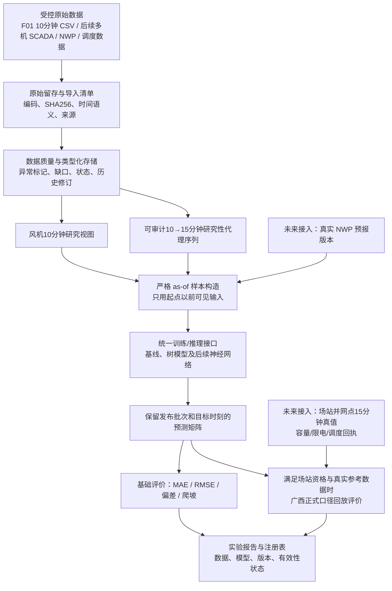

# F01 十分钟 SCADA 数据驱动的项目结构与评价体系规划

> **文档定位**：基于实际上传的单台风机数据和已完成的广西政策调研，规定后续 Agent 应如何改造项目，包括数据契约、数据库结构、预测任务、评价指标、实验隔离、实施顺序和验收条件。本文是**执行规划**，不是对代码已改造、数据库已迁移或模型已获得性能提升的声明。
>
> 关联资料：[01 广西风电功率预测考核政策与训练评估适配](01_广西风电功率预测考核政策与训练评估适配.md) · [生产数据库与接口契约](../../部署与工程/guangxi-operational-storage.md) · [本周总览](00_本周总览.md)。

## 一页结论

**当前数据能够启动单机预测研究，但还不具备场站级广西政策正式评价条件。**

| 问题 | 结论 |
|---|---|
| 目前有什么 | F01 单台风机，2023-12-11 至 2024-12-11 的 10 分钟 SCADA，52,749 行、54 列，约一年 |
| 可以马上开展什么 | 可复现的数据导入、质量治理、单机功率预测、分提前量误差、功率爬坡和运行状态分组分析 |
| 当前最合适的预测标签 | 以 `平均网侧有功功率(kW)` 作为**候选单机净功率标签**，保留负值并核实计量定义；`平均变流器有功功率(kW)` 作为对照，不可直接视为场站并网点计量 |
| 当前缺什么 | 多机组与场站并网点总功率、实际/可用功率定义、装机容量证据、历史 NWP 预报批次、15 分钟调度测量、报送记录及回执 |
| 为什么不能直接算广西准确率 | **单机 ≠ 全场；10 分钟 SCADA ≠ 调度 15 分钟参考曲线；历史实测风速 ≠ 事前可用 NWP**；同时缺历史 16 批超短期预测 |
| 数据库选型 | 沿用已选定的 **PostgreSQL + TimescaleDB**，新增独立风机 SCADA 接入层，与已有场站/预测/政策表分层连接 |
| 模型评价原则 | 所有模型均报告基础误差；数据合格时报告 15 分钟研究性指标；满足真实场站输入完整性时，才报告广西正式规则的**回放**准确率与合规性 |
| Agent 首轮目标 | **先做数据审计、版本化入库、基线和可复现评价，不直接重训或替换现有 GEFCom2014 主线** |

### 工作范围的三个层次

1. **阶段 A：单台风机离线研究（本次文件可支持）**。原生 10 分钟目标，训练简单基线及统计/树模型，验证数据治理与历史回放系统。
2. **阶段 B：单机 15 分钟研究性模拟（部分支持）**。在明确时间标签和区间平均语义后，用能量一致的重采样构建**代理标签**，研究 15 分钟曲线和滚动预测机制，但不得标为调度正式真值。
3. **阶段 C：广西风电场业务部署（尚缺外部数据）**。多风机数据、场站并网点计量、真实 15 分钟参考功率、调度状态、NWP 历史起报/接收时间、容量与报送回执齐全后，执行 D+1/超短期预测及政策准确率回放，最终与调度明细对账。

三层产物不得混写到同一张“模型准确率排行榜”而不标注任务和评价口径。

## 1. 实际数据审计：只记录已经观察到的事实

### 1.1 来源与时间范围

文件：`F01号风机十分钟数据.csv`，GB18030/GBK 兼容中文编码，实际逗号分隔，缺失值包含字符串 `--`。SHA-256：`1f81153d82242214201776d5cda6f302dc849d32f7f79f56cb3ec968f992b663`。原文件大小 15,344,580 字节。

| 维度 | 实际检查结果 | 解释 |
|---|---:|---|
| 行数与字段 | 52,749 行，54 列 | 原始 CSV 的数据行，不含表头 |
| 时间范围 | 2023-12-11 00:00 至 2024-12-11 23:50 | 原字段 `统计时间` 未携带时区 |
| 设备数 | 1 | `设备名称=F01`；`馈线名称=集电1线` |
| 型号字段 | `GW191/5270` | **型号字符串不等于已经核实的场站装机容量** |
| 名义采样步长 | 10 分钟 | 相邻时间戳最常见差值为 10 分钟 |
| 理论时间网格 | 52,848 个 10 分钟时刻 | 覆盖 367 个完整自然日 |
| 实际记录 | 52,749 | 时间戳无重复，时间单调递增 |
| 缺少网格点 | 99 | 时间网格完整率约 99.8127% |
| 完整/不完整自然日 | 310 / 57 | 按每日应有 144 个原生 10 分钟点统计 |
| 最大连续时间差 | 3 小时 | 另观察到 2 小时缺口等情况 |

**审计范围说明：**以上“完整率”仅衡量时间网格是否有记录，并不等于传感器质量合格率、训练有效率或调度数据上报率。由于原时间字符串没有时区和“区间起点/区间终点”的说明，在收到设备导出规范之前，不能擅自认定为北京时间、UTC 或具体计量区间。

### 1.2 字段结构及其用途

| 原数据字段类别 | 典型字段 | 拟定用途 | 当前限制 |
|---|---|---|---|
| 标识 | 设备名称、馈线名称、型号名称 | 风机身份、资产元数据 | 只有 F01，未提供场站完整风机清单 |
| 功率 | 平均网侧有功功率、平均变流器有功功率、无功功率 | 候选标签、计量对照、运行诊断 | 单机侧而非并网点结算表计 |
| 风况 | 平均风速、平均环境温度、平均对风角度 | 历史风况、风功率关系与历史特征 | 是**历史测量值**，不能当未来天气预报 |
| 机械与控制 | 叶轮/发电机转速、三叶片桨距角、变桨速度、偏航位置 | 历史状态、功率限制/爬坡诊断 | 可能有异常编码；未来值不可直接作为预测输入 |
| 温度监测 | 绕组、轴承、齿轮箱、机舱、进/出风口等温度 | 运行状态、设备健康辅助特征 | 部分通道存在占位值、缺失或异常值 |
| 状态时间 | 正常、发电、故障、维护、环境异常/正常时间 | 时间段运行质量、停机诊断 | 状态定义及统计窗口需源系统确认 |
| 无效/缺失 | 加速度、有效风时数、有效发电时间 | 数据质量审计 | 多列常数或全部缺失，不能作为有效模型特征 |

### 1.3 数据质量发现及处理约束

| 发现 | 文件中的证据 | 处理原则 |
|---|---|---|
| 网侧有功功率存在负值 | 9,968 条，约 **18.90%**；最小约 −31.92 kW；最大 5314.22 kW | 可能包含停机辅助用电或计量定义差异。**保留原值与标志，不一律截零或删行**；建模标签定义须经业务确认 |
| 网侧有功功率恰为零 | 290 条 | 不将零自动视为缺失；结合风速、运行时间与状态检查 |
| 风速范围 | 0 至 18.69 m/s；中位约 4.91 m/s | 可研究历史风速与功率关系，不是未来 NWP |
| 进风口温度 1、2 | 两列均只有 0 和 847 两种值，847 各出现 50,084 次 | 847℃ 不可作为合理物理温度输入；按疑似哨兵值标记，原则上从第一轮特征中排除 |
| X、Y 加速度 | 两列全部为 0 | 零方差，第一轮排除 |
| 四列风时数/有效发电时间 | `有效风时数<=3(h)`、`有效风时数>19(h)`、`有效风时数3-10(h)`、`有效发电时间(h)` 均 100% 缺失 | 不补造，不纳入模型 |
| 偏航集电环温度 | 约 12.43% 缺失；另有 12 条超过 200℃ | 保留原值与质量标志，异常值不得按常规温度处理 |
| 偏航位置 | 约 2,675 条绝对值超过 360°，原始范围约 −681.94° 至 650.55° | 可能为累计角度或坐标定义；先确认语义，再决定角度归一化/周期特征 |
| 桨距角 | 有少量大幅负值与超过 100°的记录 | 先做跨叶片一致性及状态核查，不按经验阈值静默删改 |
| 运行时间 | 少量记录的“正常/发电时间”超过 10 分钟；最大“正常运行时间”为 3 小时 | 长间隔记录可能汇总了缺失时段，需对照时间缺口；**不能只因大于 1/6 小时就直接判错** |
| 数据接收时间 | 原文件不提供 | 不能证明历史观测在某次模拟发布时已经可见；离线研究必须显式标注可用时间假设 |
| 场站总功率、可用功率、限电命令 | 未提供 | **不可计算真实广西风电场政策准确率** |

注意：`GW191/5270` 的型号名称可能暗示额定功率信息，但**不能仅凭该字符串认定额定功率为 5.27 MW**，也不能用该值替代广西政策要求的“风电场当月装机容量”。F01 文件本身没有证明其所在地属于广西；本文按未来**拟部署场景**适配广西规则，不将其视为已被考核的广西场站历史档案。

### 1.4 数据可用性结论

- **可直接用于数据工程与单机离线基线**：10 分钟历史网侧功率、历史风速、历史机械状态、日期时间和逐字段质量标记。
- **经过额外假设才可用于研究**：10→15 分钟转换、源时区、区间起/终点标签、SCADA 到达延时、机组额定功率。
- **不能从该 CSV 推出的信息**：真实 NWP 批次、未来天气、场站总出力、调度认定的可用功率、限电批准、月度装机容量、正式预测报送及回执。
- **不能宣称的结果**：真实 15 分钟并网点准确率、正式广西场站 D+1/超短期考核得分、考核费用或已完成生产部署。

## 2. 业务任务与预测输出

| 任务层级 | 研究对象 | 发布节奏 | 预测窗口 | 当前可行性 |
|---|---|---|---|---|
| `F01_NATIVE_10M` | F01 单机网侧净功率 | 研究性 10 分钟滚动 | 例如未来 10—240 分钟、每 10 分钟一值 | **可开展**。使用历史功率/风况作为已知特征，无 NWP |
| `F01_PROXY_15M` | 单机 15 分钟代理功率 | 研究性 15 分钟滚动 | 未来 15—240 分钟、每 15 分钟一值 | **有条件**。必须明确原始平均窗口及质量掩码 |
| `FARM_DAY_AHEAD` | 实际风电场并网点参考功率 | 日前按调度约定发布 | 次日全天 96 点；正式中期报送覆盖更多时刻 | **尚不可正式评价**。缺场站计量、历史 NWP 等 |
| `FARM_ULTRA_SHORT` | 实际风电场并网点参考功率 | 每 15 分钟 | 未来 15—240 分钟 16 点 | **尚不可正式评价**。缺场站计量、版本化预测等 |

**预测输出契约**：每个预测值至少携带 `asset_level`（turbine/farm）、`asset_id`、`product`、`issue_time`、`input_cutoff_time`、`valid_time`、`lead_minutes`、`prediction_value`、`unit`、`model_run_id`、`forecast_issuance_id`、`source_snapshot_id`、`label_resolution` 与 `evaluation_eligibility`。预测时间与目标时间是两条不同的轴，不允许以后一列替换前一列。

第一轮可采用**历史持续性、季节性持续性、风速—功率经验曲线、Ridge 与 LightGBM**作为可复现对照。没有未来 NWP 时不得把目标时刻的真实 SCADA 风速、温度或桨距角当作未来已知输入；D+1 若只做季节基线，应标记为“无 NWP 条件下的离线对照”，不能称为可投入业务的日前模型。

## 3. 目标系统的数据流与模块边界



模块之间应以**明确的业务契约**传递数据，算法模型不直接解析原始中文 CSV，不直接执行考核公式，也不负责调度报文拼接。这样新模型能够复用同一数据快照和评价器，并避免不同算法使用不同清洗口径。

## 4. 数据库规划：PostgreSQL + TimescaleDB

### 4.1 不重建已有实验数据库

仓库已有三层可复用能力：

- GEFCom2014 的 `wind_farms`、`power_observations`、`nwp_forecasts`、`model_runs`、`predictions` 和原来的训练/测试评估链；
- 新增但未在本次现场验证的 `alembic/versions/0003_guangxi_operational.py`，包含 `farm_capacity_history`、`operational_power`、`operational_nwp`、`forecast_issuances`、`forecast_values`、`operational_events`、`dispatch_submissions`、`dispatch_receipts`、`gx_policy_versions` 与 `gx_daily_evaluations`；
- 已提交的 `windpower.evaluation.guangxi`、`guangxi_db` 以及严格历史 as-of 取数函数。

**F01 不能直接写入 `operational_power`：**其表意是**风电场**功率，采用 MW 单位，并禁止负值；而 F01 提供的是**单机网侧** kW 功率，且有真实负值。强行写入既会破坏实体层级，也会触发约束冲突。不得为了装入 F01 而放宽场站功率表的校验规则。

### 4.2 下一版建议新增的实体

建议通过**增量 Alembic 0004** 接入以下表/视图；如果 0003 尚未部署，也应保持迁移语义清晰，避免修改已发布的历史迁移内容。

| 建议对象 | 主键/主要字段 | 作用与存储建议 |
|---|---|---|
| `data_ingest_files` | `file_id`、原文件 SHA-256、编码、大小、导入时刻、源时间语义、导入版本 | 普通表；保证重复导入幂等、可追溯和可回滚 |
| `wind_turbines` | `turbine_id`、`farm_id`（可待绑定）、原设备编码、型号、容量及证据 | 普通表；**机组容量与场站容量分开**，不凭型号推断 |
| `turbine_scada_raw_10m` | `file_id`、行序号、原始时间字符串、原始载荷、采集/接收记录 | 原始追加记录，保留原值与哨兵值；不可直接当特征集 |
| `turbine_scada_10m` | 风机、规范化时间、来源版本、功率、风速、控制状态、`quality_flags`、raw 引用 | 时序主体，适合 hypertable；允许单机净功率负值 |
| `turbine_power_15m_proxy` | 风机、15 分钟目标、转换方法、原始数据覆盖/权重、标签版本 | 派生视图或物化结果；**research_only** 标记 |
| `feature_snapshot_manifest` | 预测发布 ID、输入截止时刻、数据哈希/版本、假设及缺失摘要 | 预测审计与回放；不一定需要另造每个特征的存储表 |
| 现有 `operational_power` 等 | 保持与原 0003 一致 | 后续拿到真实场站资料再写入，不从 F01 推算填充 |

推荐实体关系为 `wind_farms (1) → wind_turbines (N) → turbine_scada_10m`；`farm_meter_15m` 或现有 `operational_power` 记录**独立的并网点计量**，不默认等于风机功率简单求和。若存在场内损耗、弃风、储能或多馈线计量，必须在业务层明确边界。

### 4.3 存储与索引约定

- 高频、已规范时间的观测与历史版本表采用 `TIMESTAMPTZ`，按实体+时间索引；TimescaleDB hypertable 采用时间列分区，唯一/主键必须包含分区时间。发布批次、场站、设备、回执、政策和评分保持普通 PostgreSQL 关系表。
- 原 CSV 的无时区字符串必须单独保留；只有源系统确认时区与“区间起点/终点”语义后，才转换为正式 UTC 时间键。
- 类型化热字段（功率、风速、转速、桨距、状态时间）应使用列式字段，原始全量字段另存不可变原始记录。**不建议为每个传感器读数建立一张独立键值表**，会显著增加多变量同时读取的成本。
- 迟到数据、修订数据、新预测批次采用**追加式版本**，查询用明确的 `as_of` 规则选取版本；不得覆盖调度原始提交和回执。
- 不启用未经审核的自动清理/压缩策略；真实 SCADA、考核及报送历史的留存周期由场站合规要求决定。
- 原始 CSV 不进入公开 GitHub。仓库只提交**数据字典、聚合审计、代码、合成测试和文档**。实际训练数据由受控存储提供给 Omarchy，路径由环境配置指定，不能推测上传文件在远程服务器的位置。

## 5. F01 数据契约与第一轮特征

第一轮模型不必使用全部 54 列。建议建立以下映射（命名为目标字段名，并保留原始列名、单位、版本）：

| 原始字段 | 规范化字段 | 角色 |
|---|---|---|
| 设备名称 | `turbine_external_id` | 主体键 |
| 统计时间 | `source_time_text`，确认后映射 `interval_start_at`/`interval_end_at` | 时间键 |
| 平均网侧有功功率(kW) | `grid_active_power_kw_raw` | 主要候选标签 |
| 平均变流器有功功率(kW) | `converter_active_power_kw_raw` | 对照标签及功率诊断 |
| 平均风速(m/s) | `nacelle_wind_speed_ms` | 仅历史可见输入 |
| 平均环境温度(℃) | `ambient_temp_c` | 历史特征 |
| 平均叶轮转速瞬时值(rpm) | `rotor_rpm` | 历史状态 |
| 平均发电机转速瞬时值(rpm) | `generator_rpm` | 历史状态 |
| 三叶片桨距角 | `pitch_1_deg`、`pitch_2_deg`、`pitch_3_deg` | 历史控制状态、异常识别 |
| 平均偏航位置(deg) | `yaw_position_raw_deg` | 原始角度；待确认是否可取模 |
| 平均对风角度(deg) | `yaw_error_deg` | 历史偏航误差 |
| 风机发电/故障/维护时间(h) | `generating_h`、`fault_h`、`maintenance_h` | 区间状态摘要，解释异常和标签 |
| 原始哨兵/缺失字段 | `quality_flags` / 原始载荷 | 可审计的排除、掩码或异常来源 |

初期特征按**预测发布时刻已知**的历史窗口构造：过去 10、20、30、60 分钟与过去 2、4、24 小时的功率/风速统计、最近的功率变化、运行状态历史摘要、小时/日/月份周期特征。历史传感器状态只能进入 `issue_time` 以前的输入；不使用未来时刻的网侧功率、机舱风速、温度、叶片角度或运行状态。

风向/偏航角是否适合转为 `sin/cos`，须依据原字段物理语义；转速和温度的异常值采用质量掩码，不能通过全数据集拟合均值填补后造成跨分割泄漏。标记的异常数据应保留原值，供不同清洗策略做训练集消融。

## 6. 10 分钟到 15 分钟的时间对齐

这是本项目与广西业务存在的首要分辨率差异。

如果**经过源系统确认**，原 CSV 中每条 `统计时间=t` 表示时间段 `[t,t+10min)` 的**平均功率**，可以按功率的时间积分，构造研究性 15 分钟区间平均值：

```text
原始区间（示例）：
00:00–00:10  P0
00:10–00:20  P1
00:20–00:30  P2

研究性 15 分钟区间：
00:00–00:15  (10·P0 + 5·P1) / 15
00:15–00:30  ( 5·P1 +10·P2) / 15
```

一般形式为：

\[
\widehat P_{[a,b)}
=\frac{\sum_k \mathrm{overlap}([a,b),[t_k,t_k+10m))\,P_k}{b-a},
\quad b-a=15m.
\]

例如三段 10 分钟平均功率分别为 1000、1500、2000 kW，则上述两个 15 分钟**代理区间**功率依次为约 1166.67、1833.33 kW。该换算对不跨越已知 10 分钟平均区间的能量保持一致，但 15 分钟边界切穿 10 分钟区间时，采用了区间内部恒定的近似；**它不能恢复调度计量表的原始 15 分钟真值**。

对本文件，在“10 分钟时间戳均为区间起点、所有行的平均值有效”这两个**尚未证实的假设**下，共有 35,232 个候选 15 分钟时段，其中 35,125 个拥有完整所需 10 分钟时间记录，107 个缺少至少一段贡献。**这是理论时间覆盖统计，不是已生成或已检验的真实 15 分钟功率数据，更不是政策有效点数。**

必须同时满足以下限制：

1. 输入某个 15 分钟区间的全部原始贡献区间都存在；缺失不得按已有样本重新归一化为 100%。
2. 每个时段保存原始 10 分钟记录 ID、重叠分钟权重、时间语义版本与 `research_only` 标记。
3. 若原文件其实是**区间终点标签**、滑动平均或其他统计方式，上述起点公式必须重写；Agent 不得自行猜测。
4. 由原生 10 分钟推导的 15 分钟代理指标可以用于模型工程比较，但不能与真实 15 分钟并网点计量或广西正式准确率混同。
5. 训练、验证、测试边界附近的数据窗口应按**输入可见时间**确定，不能利用尚未结束的平均区间作为历史已知输入。

## 7. 模型路线与可行的对照实验

### 7.1 第一阶段：单机研究

优先实现两类预测：

- **原生 10 分钟单机滚动预测**：未来 10—240 分钟，每个提前量分别统计误差，并输出整条预测曲线。至少对比“最后一个可见功率值”的持续性基线、“同一时段的历史规律”基线、Ridge 和 LightGBM。
- **固定起点的长提前量预测诊断**：在没有真实历史 NWP 的条件下，用仅依赖历史值的简单方法评估长提前量不确定性。此处目标是测量数据与任务难度，**不宣称获得可部署的 D+1 算法**。

模型选择应先针对目标预测窗口、误差稳定性、低风速/大风/停机分组及功率爬坡进行比较，不因为复杂模型在某个总体 RMSE 上偶然占优就直接替换基线。

### 7.2 后续阶段：真实 NWP 和场站任务

引入真实气象预报后，才开始正式设计：

- D+1：在日内规定截止时刻，以截止前已经发布和收到的 NWP 预测次日 96 点；实际中期报送覆盖未来 240 小时，按现场要求实现。
- 超短期：每 15 分钟重新发布未来 16 点，结合已到达的最新 SCADA、NWP 以及可用的调度/限电信息。
- 多机/全场：可比较“各机预测后聚合”和“直接预测并网点功率”两条路线，场内损耗与储能影响应显式建模；是否融合多机由真实数据覆盖决定。

**训练未来 SCADA 风速直接预测同一时刻功率可以形成近似风速—功率回归曲线，但如果该风速不是发布时刻可用的 NWP，它不是一个合格的未来功率预测实验。**所有训练与回放必须先从发布时间构造可用信息，再生成特征。

## 8. 评价体系：分三个层级，绝不混淆

### 8.1 第一级：单机离线指标（本次数据可以计算）

对固定场站/风机、固定目标、固定有效点集合，定义 `e_i = predicted_kw_i - observed_kw_i`：

\[
\mathrm{MAE}_{kW}=\frac1N\sum_i |e_i|,
\qquad
\mathrm{RMSE}_{kW}=\sqrt{\frac1N\sum_i e_i^2},
\qquad
\mathrm{Bias}_{kW}=\frac1N\sum_i e_i.
\]

必须同时输出：

| 指标 | 目的 | 约束 |
|---|---|---|
| MAE、RMSE、Bias（kW） | 基础点预测性能 | 固定同一批有效样本比较 |
| 提前量 MAE/RMSE（10、20……240 分钟） | 区分短提前量与长提前量能力 | 不混淆超短期官方 15 分钟网格 |
| 归一化 MAE/RMSE | 比较不同容量风机 | **只有权威额定功率已确认后**，才按规定容量归一化 |
| 低风速、正常风速、高风速分组 | 检查风况适应性 | 风况分组阈值作为研究配置记录，不声称官方标准 |
| 大功率爬坡误差、爬坡方向准确率 | 评估突变预测能力 | 事件阈值预注册；不根据测试集选择 |
| 负值/零值/停机/故障分组 | 检查净功率与异常运行 | 不静默删除；结果同时注明清洗策略 |
| 覆盖率、缺失率、预测缺报数 | 评价工程稳定性 | 缺失样本单独报告，不把缺报日当作“好成绩” |
| 计算耗时与延迟 | 支撑滚动预测可实施性 | 在 Omarchy 实测，记录机器配置与批量大小 |

可选 WAPE / sMAPE 需明确分母处理，尤其当前数据存在大量零值和负值。第一轮不以 MAPE 为主要比较指标，也不从型号字符串推断 `C` 来生成漂亮的归一化百分比。

### 8.2 第二级：15 分钟单机代理指标

如果完成第 6 节的数据语义确认与代理序列构造，可在对应的研究性 15 分钟标签上计算上述基础指标、15/30/45……240 分钟提前量误差以及 96 点业务日的覆盖情况。

此时结果必须携带：

```json
{
  "asset_level": "turbine",
  "target_source": "derived_from_10m_scada",
  "resolution_minutes": 15,
  "label_kind": "interval_average_proxy",
  "policy_eligible": false,
  "GX_policy_accuracy": null,
  "ineligible_reason": "single_turbine_proxy_not_dispatch_farm_reference"
}
```

即使一个研究性 15 分钟业务日拥有完整 96 点，也**不能因此自动获得广西正式政策准确率**。

### 8.3 第三级：广西场站政策指标（需要完整场站数据）

采用本仓库已有的规则版本化评分器，核实正式公开版以 `GX_WIND_PUBLIC_2025` 标识：日前准确率门槛 **60%**，超短期 **65%**；广西附表中 `A3=A4=2`。2026 年 8 月征求意见稿`GX_WIND_DRAFT_202608`拟将门槛调整为 **65%/75%**并改变超短期误差聚合顺序。**草案不作为已核实生效规则，必须分开报告。**

在完整 96 点且参考功率、容量、有效性条件确认时，定义：

\[
b_i=\max(P_i,0.2C),
\qquad
a_{\mathrm{DA}}=1-\sqrt{\frac1{96}\sum_{i=1}^{96}
\left(\frac{P_i-\widehat P_i^{DA}}{b_i}\right)^2}.
\]

对同一目标时刻 `t_i`，正式版先把此前 16 次历史发布预测取均值：

\[
\overline P_i=\frac1{16}\sum_{j=1}^{16}
\widehat P(t_i\mid t_i-j\cdot15\,\mathrm{min}),
\qquad
a_{\mathrm{US}}=1-\sqrt{\frac1{96}\sum_{i=1}^{96}
\left(\frac{P_i-\overline P_i}{b_i}\right)^2}.
\]

`P_i` 的正式参考功率应依规则在不限电时取实际功率、限电时取可用功率，并结合场站认可的豁免处理。该公式是**场站日准确率**，不是某一个 10 分钟单机点的误差。准确率应保存原值、阈值、达标标识、有效点数、缺报/迟报记录及每个提前量独立诊断。

政策考核包括准确率和预测上报率，但**不能仅由一份历史 SCADA 计算报送成功率**；上报率需要应报批次数、报送文件、提交时刻及调度侧回执。准确率差额折算的考核电量、月度封顶与费用也需要经调度明细核对后才成为正式结算结果。

### 8.4 评价结果的资格判定

| 条件 | 单机离线 MAE/RMSE | 单机 15 分钟代理 | 广西场站政策回放 |
|---|---|---|---|
| 仅 F01 的 10 分钟数据 | 可做，需处理缺失及状态 | 暂不可，先确认源时间与窗口语义 | **禁止** |
| 确认 10 分钟标签与合法重采样 | 可做 | 可做，标记研究用途 | **禁止** |
| 另有全场 15 分钟并网点参考功率与装机容量 | 可做 | 可做 | 仍需 NWP、完整预测批次与状态证据 |
| 具备冻结的日前/超短期预测、实际/可用功率、规则版本与完整回执 | 可做 | 可做 | 可做**研究性政策回放**，须再核对豁免/缺报执行口径 |
| 获得调度考核明细并完成逐项对账 | 可做 | 可做 | 才能称为与实际调度结算一致的考核复现 |

历史数据为 **2023—2024 年**，早于报告中核实的 2025 年正式版实施时间；即使未来得到全部资料，使用 2025/2026 规则给这段历史评分，也应称为**跨规则时期的反事实研究回放**，不能当作该时间段真实发生的监管考核结果。

## 9. 数据划分和防止未来信息泄漏

### 9.1 F01 数据独立划分建议

建议对 F01 单机新任务**单独预注册**如下候选时间边界（采用目标时刻所在日，时间精度按源数据确认后落实）：

| 用途 | 候选目标时间区间（左闭右开） | 允许用途 |
|---|---|---|
| 训练 | 2023-12-11 至 2024-09-01 | 模型拟合、训练期特征统计 |
| 验证 | 2024-09-01 至 2024-11-01 | 模型选择、早停、融合与门禁 |
| 测试 | 2024-11-01 至 2024-12-12 | **一次性最终评分**，不进行调参、清洗阈值选择和模型选择 |

该划分是**建议，尚未作为实际实验批准执行**。只有约一年数据，季节覆盖和分布漂移仍是风险。若未来有更多年份，应优先扩大训练跨度，并保留独立季节/天气事件评估。

此前 GEFCom2014-Wind 的实验协议（2012 年训练、2013 上半年验证、2013 下半年测试及预注册门禁）**保持不变**。F01 另建数据集和实验登记，不复用 2012/2013 数据分割配置，也不对既有模型成绩重新排序。

### 9.2 滚动回放规则

- 样本以 `issue_time` 定义输入截止，目标集合按 `valid_time` 划入训练、验证或测试；同一发布批次若目标跨越分割边界，要么整体归一段，要么拆分后严格防止同一目标信息跨段泄漏。
- 边界附近要求明确数据上下文与隔离带；模型允许使用该预测起点以前**已经发生且当时可见**的历史数据，但不得利用未来标签构造特征、归一化统计或清洗阈值。
- 历史 SCADA 缺 `received_at`，因此第一轮只能采用显式的“离线可见性/固定延迟假设”。真实实时能力只有接入真实接收时间后才能验证。
- NWP 必须按预报起报和**实际到达时间**做 `as-of` 版本选择；事后最新 NWP、分析场、未来真实机舱风速均不能取代事前预报。
- 所有模型必须在同样有效的目标点集合上配对比较；缺失、故障和限电的处理规则在验证前确定，不能看测试结果之后再改。
- 统计不确定性按连续日或预注册的七日块配对计算，不能把重叠滚动窗口当作独立样本。
- 当前只做文件**元数据与质量审计**，不从测试区间计算误差、挑选模型或制定异常阈值；首轮 Agent 应先冻结评价方案再打开测试成绩。

## 10. 统一评价接口与报告输出

建议实现统一接口：

```python
evaluate(
    dataset_id,
    dataset_version,
    asset_level,           # turbine | farm
    product,               # native_10m | proxy_15m | day_ahead | ultra_short
    target_definition,
    model_run_id,
    prediction_series_id,
    split_name,
    reference_source,
    as_of,
    policy_version=None,   # only eligible farm products
)
```

最小报告字段：

| 分组 | 必须输出 |
|---|---|
| 身份 | 数据集及其 SHA/版本、机组或场站 ID、模型与代码提交、业务时区假设、数据分割 |
| 预测 | 产品、发布时间和目标时间网格、提前量、输出单位、发布批次版本 |
| 标签 | 网侧/变流器/并网点、原生/代理、传感器来源、时间对齐方式、缺失与异常掩码 |
| 基础指标 | MAE、RMSE、Bias、各提前量、分风况与状态、有效样本数 |
| 业务指标 | 15 分钟曲线点数、每日报送完整性、延迟/缺报、政策适用资格 |
| 政策指标 | 若合格则输出正式版准确率、阈值、达标情况、草案单列；否则显式 `null` + 不适用原因 |
| 审计 | 参数配置、数据快照、输入可见时间假设、程序版本、生成时刻、异常清单 |

建议每次运行同时产生 `summary.json`、`per_lead.csv`、`per_day.csv`、`quality_report.json` 与可阅读的 `report.md`；通过固定的 `run_id` 和 `dataset_version` 关联数据库记录。**任何缺少数据资格的分数不得以 `GX_policy_accuracy=0` 替代 `null`**：零分是明确的政策计算结果，缺数据是无法评价，两者含义完全不同。

## 11. Agent 改造任务卡与验收门禁

原则：**先审计，后建表，再做基线与评价；最后在外部数据齐全时接入真实场站和正式政策。**以下任务只定义要完成的工作和可验收的证据，并不表示已在当前仓库实施。

| 编号 | 优先级 | 任务 | 建议改动范围 | 完成标准 |
|---|---|---|---|---|
| T00 | P0 | 检查仓库与数据可访问性 | `AGENTS.md`、现有 migration/评价器、原始文件路径、许可证与权限 | 明确当前 HEAD、数据哈希、是否持有原始 CSV；不得假定文件已经在 Omarchy |
| T01 | P0 | F01 原始导入与字段审计 | `src/windpower/data/scada_f01.py`（建议）、`tests/test_scada_f01.py`、`docs/研究记录/` | 可读 GB18030、识别 `--`，报告 54 列、52,749 行和时间缺口，重复导入幂等；不上传原始 CSV 到公共仓库 |
| T02 | P0 | 单机资产表及原始/规范 SCADA 存储 | **新增** `alembic/versions/0004_...`、`src/windpower/db/` | 保留 kW 负值与原始记录，设备-场站关系可为空，主键不把多个来源修订覆盖；0001—0003 兼容；不修改生产数据 |
| T03 | P0 | 质量规则与时间语义 | `src/windpower/data/quality_*.py`、`tests/test_scada_quality.py` | 847 等异常、全缺失、常数、负功率和长时间间隔分别标记；区间起止标签未确认时不能擅自输出正式 UTC/15 分钟真值 |
| T04 | P0 | 原生 10 分钟样本和基线 | `src/windpower/features/`、`models/`、`evaluation/` 的独立 F01 管线 | 支持历史可见性约束、持续性/Ridge/LightGBM；验证期有逐提前量 MAE/RMSE，测试仍被门禁关闭 |
| T05 | P1 | 15 分钟研究性代理构造 | `src/windpower/data/resample_*.py`、`tests/test_interval_alignment.py` | 在时间标签**已确认**后，用重叠分钟权重处理 10→15；缺一段则标记缺失，保留原始贡献索引；标签始终 `research_only` |
| T06 | P1 | 统一评价接口与三层资格控制 | `src/windpower/evaluation/`、配置和测试 | 保留基础指标；不具备场站资格则政策分数字段为 `null` 并给原因；正式/草案规则分离；已提交的 `guangxi.py` 合成单测在 Omarchy 实际运行并记录结果 |
| T07 | P1 | 训练/验证/测试注册表与报告 | `configs/`、`scripts/`、`docs/研究记录/` | F01 独立时间划分与数据集版本固定；七日块配对统计；保存 run manifest、逐日/提前量报表；不影响 GEFCom2014 历史成绩 |
| T08 | P2 | 接入真实场站/NWP/容量与报送 | 0003 业务表、真实 as-of 查询、调度适配器 | 15 分钟并网点真值及调度容量、参考功率/限电、历史 NWP 和全部发布批次均可回放；无未来信息 |
| T09 | P2 | 广西政策评价与生产影子运行 | `guangxi_db.py`、监控与对账模块 | 每日 96 点、超短期历史 16 版、上报率、各提前量误差和草案对照可审计；与调度明细对账后才升级为正式结算复现 |

### 11.0 执行状态（2026-11-21，Omarchy 实测）

| 编号 | 状态 | 证据 |
|---|---|---|
| T00 | **完成** | HEAD `1dbf260`；原始 CSV 在 Omarchy `data/raw/f01/`（已 gitignore），SHA-256 与本文件登记一致 |
| T01 | **完成** | `src/windpower/data/scada_f01.py` + `tests/test_scada_f01.py`（GB18030/`--`/哈希/幂等共 9 用例）；审计报告 [docs/研究记录/f01-data-audit.md](../../研究记录/f01-data-audit.md) + `artifacts/f01/quality_report.json`；规划 §1 全部数字复核通过，时间缺口最大 180 分钟属实 |
| T02 | **完成** | Alembic `0004_turbine_scada.py`（六表 + 跨 metadata 外键）；Omarchy 迁移至 0004；F01 入库 52,749 行（原始 JSONB + 规范行），负功率 9,968 条保留，重复导入两次幂等；GEFCom 表未动 |
| T03 | **完成** | `src/windpower/data/quality_scada.py` + `tests/test_scada_quality.py`（12 用例）；哨兵/零方差/全缺失/负功率/长状态/缺口规则全部预注册、只标记不删改；无时区源时间保持 naive，未擅自转 UTC |
| T04 | **完成** | `configs/f01_experiment.json` 预注册协议 + `features/scada_samples.py` + `models/scada_train.py` + `evaluation/scada_eval.py`；验证期结果见 [docs/研究记录/f01-baseline-first-round.md](../../研究记录/f01-baseline-first-round.md) 与 `artifacts/f01/summary.json`；门禁 pass 后于 2026-11-22 经用户授权打开测试集，以冻结模型执行一次性最终评分（最优 LightGBM RMSE 877.2 kW；验证期排序未延续到测试期，已如实记录）；防泄漏/协议测试 22 项全绿 |
| T05 | 函数与合成测试已交付，真实代理标签**阻塞**（源区间语义未确认） | `src/windpower/data/resample_15m.py` + `tests/test_resample_15m.py`（规划 §6 算例、缺段不重归一化、research_only）；`turbine_power_15m_proxy` 保持 0 行 |
| T06 | 部分完成 | 单机政策字段 `null` + 原因已实现并测试；`guangxi.py` 合成单测在 Omarchy 运行通过；完整统一接口待场站数据 |
| T07 | 部分完成 | F01 独立划分与数据集版本已在配置与 run manifest 固定；七日块配对统计待下一轮开测试集时实施 |
| T08—T09 | 未执行（缺真实场站/调度数据） | 阻塞项见 §12 |

### 11.1 首轮 Agent 的交付物（T00—T04）

1. 一份 `data-audit.md` 和机器可读 `quality_report.json`，与本节已核实事实能对账；每条异常规则含单位、原始列、版本、影响行数和审计样例。
2. 一份独立 F01 数据字典与 PostgreSQL 增量迁移；数据导入不依赖重建旧 GEFCom2014 表。
3. 一套有测试的原生 10 分钟离线样本构造与持续性/基础模型，对每个目标时刻证明没有使用未来风速、未来状态或未来功率。
4. 仅使用训练/验证集形成的基线评价、逐提前量结果和运行清单；**不打开测试集选型**。
5. 保留项目既有单测、迁移和回放功能；在 Omarchy 上运行验证，失败记录原因和复现命令，不因追求“全绿”而删测试。

### 11.2 必须覆盖的自动化测试

| 测试类别 | 关键场景 |
|---|---|
| 编码/文件 | GB18030 中文头、`--` 解析、原文件 SHA-256、重复导入不增行 |
| 时间轴 | 10 分钟间隔、缺口、闰年、日/月边界、无时区源时间不得默默转换 |
| 数值质量 | 847 哨兵、全空列、全零列、负功率保留、状态时长可能跨缺口 |
| 区间换算 | 10/5 分钟加权；缺原始时段不重归一化；起点/终点标签差异；代理标签不具政策资格 |
| 防泄漏 | 目标时间的 SCADA 风速不可进未来特征；输入截止后的 NWP/传感器修订不可见 |
| 预测矩阵 | 同一目标可对应多个发布时间；发布版本不覆盖；提前量和单位正确 |
| 评价 | 基础 MAE/RMSE 算例；单机政策字段为 `null`；完整场站合成数据验证 96 点与超短期 16 版公式 |
| 实验协议 | 训练/验证/测试目标集合不交叉，缺失处理仅在允许的集合中确定；保留 GEFCom2014 原协议 |

## 12. 真实场站部署前还需补充的数据

| 必要资料 | 当前文件是否提供 | 为什么不可缺 |
|---|---|---|
| 风电场与 F01 的设备归属、完整风机清单 | 否 | 确认单机/场站汇总边界 |
| 单机额定容量及风电场当月并网装机容量 | 否 | 归一化指标、容量历史、政策分母 |
| 源时间时区、10 分钟区间起/终点与数据到达延时 | 否 | 合法重采样和严格 as-of 回放 |
| 场站并网点 15 分钟实际有功功率 | 否 | 正式准确率参考曲线 |
| 场站可用功率/理论功率及计算方法 | 否 | 限电场景的政策参考功率 |
| AGC/限电/故障/检修与经认可的豁免记录 | 否 | 训练标签清洗与有效考核掩码 |
| 历史 NWP，含模式、起报时间、实际接收时间、有效时间 | 否 | 可部署的 D+1 与超短期前瞻预测 |
| 正式发报格式、应报次数、提交与接收回执 | 否 | 生产上报及上报率评价 |
| 调度侧日/月考核细则与实例 | 否 | 缺失、豁免、进位、月度费用对账 |

**输入资料的优先级**：先确认 F01 时间和功率定义，保证本次文件可用于单机研究；随后争取历史 NWP 和场站并网点 15 分钟真值；最后接入容量、限电和调度回执以完成政策评价。用户尚未提供的数据只能列为依赖，不能由 Agent 生成合成替代品后宣称真实评价。

## 13. 与现有仓库的兼容和迁移策略

- **保留**：GEFCom2014-Wind 小时级基准、已有模型/图表/评价注册表及严格 2012/2013 协议。
- **复用**：SQLAlchemy/Alembic、PostgreSQL 连接、模型运行记录、NWP 版本化设计、发布矩阵与广西公开公式评分纯函数。
- **新增**：风机资产与 SCADA 导入层、10 分钟原生目标、15 分钟代理标记、质量报表、F01 独立训练/评价配置、三层模型结果资格控制。
- **禁止**：把单机原始负功率写入场站 `operational_power`；更改旧基准的单位或时间语义；重写历史 Alembic 迁移掩盖已部署版本；把原始用户数据上传公共 GitHub；在没有场站资料时用模型推测可用功率作为自身的正式考核真值。
- **上线步骤**：数据库版本与备份预检 → 迁移测试环境 → 原始入库与质量审计 → 单机模型影子回放 → 真实场站/NWP 接入 → 15 分钟发布与政策评价 → 调度回执对账 → 生产影子运行 → 获得批准后正式报送。

## 14. 交给 Agent 的执行要求

**任务依据**：以本文件为实施任务书，以 `AGENTS.md` 为最高项目约束，以仓库当前 `main` 及现场真实数据为准。先阅读本文件、前一份广西政策报告、0001—0003 迁移、现有评估与测试代码，然后执行 T00—T04。优先完成**真实数据可复现的输入—样本—基线—评价闭环**，不得仅重画架构或生成没有测试的代码框架。

每张任务卡完成后，提交以下最小证据：

- 改动文件、目的、数据与模型版本；
- 单测和集成测试的**实际运行**命令及通过/失败记录；
- 训练/验证样本数与标签时间范围，确认未触及独立测试门禁；
- 质量规则造成的保留/剔除/标记数量；
- 下一阶段仍缺的真实场站信息与外部接口。

当依赖项缺失时，Agent 应停在相应阶段，提交明确的阻塞说明和可验证的合成测试，不得臆造场站、容量、NWP、政策有效期或经济金额。数据库、训练、推理和测试在 **Omarchy** 执行；Mac 仅作为编辑和 SSH 跳板。未经用户明确授权，不改动在线生产数据库，不向任何调度系统真实报送。

## 15. 资料依据与时间性说明

1. **本次上传数据**：`F01号风机十分钟数据.csv`，经本地只读解析与聚合统计取得第 1 节各数值。报告只公开字段及聚合结果，不包含完整原始数据或可重建的逐行测量值。源时间与业务语义未验证。
2. [正式公布的《南方区域风电并网运行及辅助服务管理实施细则》](https://nfj.nea.gov.cn/xwzx/tzgg/202502/P020250214585645425665.pdf)，第 22 条及广西参数附表。适用范围是相关调度机构管理的**风电场**，不是任意单台风机的 SCADA 文件。
3. [2026 年 8 月《南方区域“两个细则”部分条款修订（征求意见稿）》](https://nfj.nea.gov.cn/xwzx/tzgg/202608/P020260824351987511048.pdf)，拟议值单独记录，本轮不将其当作已实施规则。
4. [TimescaleDB 官方约束与唯一索引说明](https://github.com/timescale/docs/blob/latest/use-timescale/hypertables/hypertables-and-unique-indexes.md)，时间分区列必须包含在 hypertable 的唯一/主键中。
5. 仓库既有 [第一份广西政策报告](01_广西风电功率预测考核政策与训练评估适配.md)、[生产数据契约](../../部署与工程/guangxi-operational-storage.md)、[AGENTS.md](../../../AGENTS.md)，已有工作完成情况应由真实代码和运行证据判定。

**截至 2026-11-21 晚间更新：T00—T04 已按本文件在 Omarchy 实际执行并通过测试**（执行状态见 §11.0，
审计与基线报告见 `docs/研究记录/f01-data-audit.md`、`docs/研究记录/f01-baseline-first-round.md`）。
测试集已于 2026-11-22 一次性评分完毕，15 分钟真实代理标签仍阻塞于源区间语义确认；尚无任何可部署的 D+1 模型宣称。
