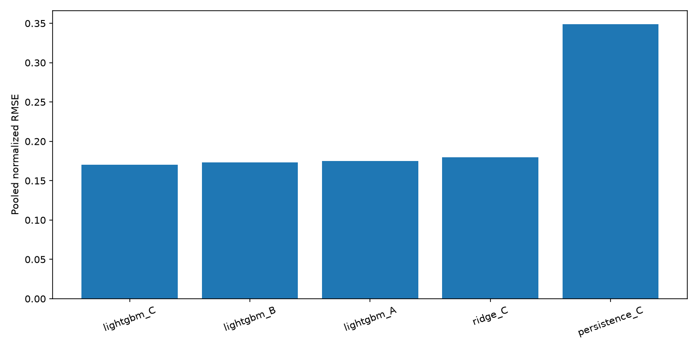
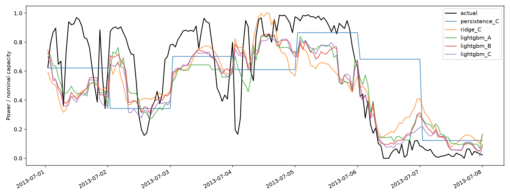
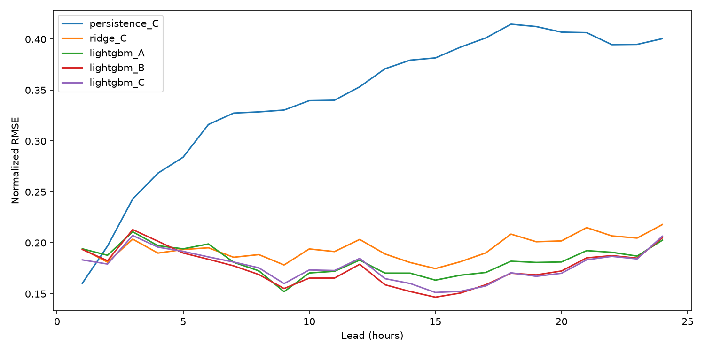
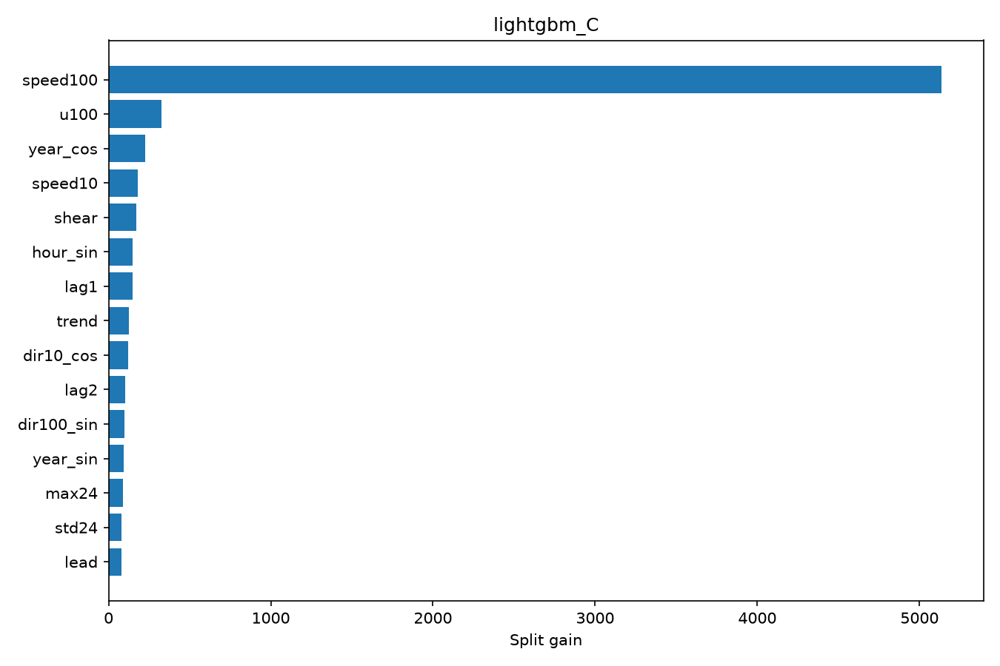

# 实际验收与实验报告

> **口径说明**：本文档记录的是**优化前的基线实验**（十站合并 RMSE 0.170454）。经过 9 个优化节点后的当前结果为 **0.156009848**，见 [optimization-progress.md](optimization-progress.md)；两者不可混用。

执行日期：2026-11-09。全部数字来自本目录实际下载、PostgreSQL 查询、训练及预测，不是示例指标。

## 已完成范围

真实官方完整 ZIP 下载成功，大小 126,360,077 字节。仅使用官方 Wind V2 Task 15 历史、预报及答案文件，没有复制其他预测仓库。10 个场站各 17,544 小时，覆盖 2012-01-01 01:00 至 2014-01-01 00:00；源数据均无重复时间、无时间轴缺口、NWP 四分量无缺失或非有限值。

功率共 175 个缺失值，不插补，不填造；在数据库保留 NULL 和字段质量标记。缺失标签或历史窗口会排除整个预测日，使每站五个模型使用同一批样本。

Python 3.13.15，uv 锁定依赖。数据库实际为 PostgreSQL 18.6 (Homebrew)，本机 TCP 127.0.0.1:55432。Docker 未安装，Compose 的 postgres:18.6 路径没有实际启动验收；已提供所需镜像、仅本机端口、健康检查及 /var/lib/postgresql 卷配置。

## 单站闭环与十站样本

|场站|原始小时|缺失功率|训练样本|验证样本|测试样本|测试完整日|
|---|---:|---:|---:|---:|---:|---:|
|1|17544|18|8736|4104|4104|171|
|2|17544|21|8736|4152|4080|170|
|3|17544|94|8736|4344|3504|146|
|4|17544|6|8736|4344|4392|183|
|5|17544|6|8736|4344|4392|183|
|6|17544|6|8736|4344|4392|183|
|7|17544|6|8736|4344|4392|183|
|8|17544|6|8736|4344|4392|183|
|9|17544|6|8736|4344|4392|183|
|10|17544|6|8736|4344|4392|183|

固定边界：训练目标 (2012-01-01, 2013-01-01]；验证 (2013-01-01, 2013-07-01]；测试 (2013-07-01, 2014-01-01]。完整日筛选使目标窗口不越界。前 24 小时历史不足的初始起点也排除。所有正式样本均从 PostgreSQL 查询构造。

## Zone 1 实测指标

|模型|MAE / nMAE|RMSE / nRMSE|测试小时|
|---|---:|---:|---:|
|persistence_C|0.253984|0.350177|4104|
|ridge_C|0.152643|0.194905|4104|
|lightgbm_A|0.141617|0.182709|4104|
|lightgbm_B|0.134335|0.176497|4104|
|lightgbm_C|0.134775|0.177484|4104|

Zone 1 物理特征 B 优于原始 A；历史功率 C 没有进一步降低 RMSE。这是本次固定配置下的实测结果，未根据测试表现重新选择参数。

## 十站合并指标

以下按实际有效小时数加权，RMSE 先合并平方误差再开根，避免不同缺失量造成站点权重错误。每个模型共 42,432 个独立测试小时；五模型合计 212,160 个最新实验预测值。

|模型|MAE / nMAE|RMSE / nRMSE|测试小时|
|---|---:|---:|---:|
|lightgbm_C|0.123454|0.170454|42432|
|lightgbm_B|0.125383|0.173109|42432|
|lightgbm_A|0.125312|0.174730|42432|
|ridge_C|0.133749|0.179524|42432|
|persistence_C|0.255642|0.348900|42432|

十站整体 C 的 RMSE 最低，但并非所有场站都受益。B 相对 A 的合并 RMSE 改善约 0.001622，C 相对 B 改善约 0.002655；Zone 1/3/4/10 的 C 相对 B 反而更差。只说明此数据、此划分和此固定模型配置下的贡献，不能推断因果或保证生产收益。

功率已归一化到额定容量 1，故 nMAE=MAE、nRMSE=RMSE；数值乘 100 是额定容量百分比，不是 MW。模型输出统一裁剪 [0,1]。各站和 1–24 小时分时效指标保存在每站 metrics.csv 和 lead_metrics.csv。

## 数据库和可重复性验收

|验收项|实际结果|
|---|---|
|PostgreSQL 18.6 连接、Alembic 迁移|通过；使用本机原生实例|
|官方真实数据导入|10 个场站通过|
|质量检查|时间连续，无重复；175 个功率缺失明确标记|
|未来 NWP 与历史特征|统一构造逻辑，历史严格早于起点|
|三个模型及三组 LightGBM 消融|每站 5 组，共 50 组最新模型通过|
|独立测试、预测写库和图表|十站通过；已抽查预测曲线及特征重要性 PNG|
|重复导入及重复预测|实际再次运行，前后全部六表行数一致|
|干净数据库与新 Python 环境重跑|通过；Zone 1 指标逐项与原实验完全一致|
|Docker Compose 实际启动|未执行：本机没有 Docker|

验收时数据库表行数：

|表|行数|
|---|---:|
|wind_farms|10|
|power_observations|175440|
|nwp_forecasts|175440|
|dataset_splits|3|
|model_runs|55|
|predictions|232680|

55 个 model_runs 包括最初 Zone 1 的 5 组实验和随后十站的 50 组。232,680 个预测包括旧实验，最新十站模型为 212,160 个。重复预测 upsert 不增加记录；重复训练按设计保留新 UUID。清洁重跑另用 windpower_repro 数据库，不混入这些行数。

空环境重跑目录 /private/tmp/windpower-replay，独立虚拟环境 /private/tmp/windpower-replay-venv，空数据库 windpower_repro。原始 ZIP 复用本次真实下载缓存，迁移、导入、训练、预测和报告全部重新执行。重跑没有再次从网络下载 120 MiB 文件；首次下载已实际验证。证据见 artifacts/reproducibility.json、reproducibility.log 和 acceptance.json。

自动化测试：7 项通过，含真实 PostgreSQL 结构/预测约束、未来功率不影响特征、精确滞后缺失、日界提前量、划分边界、非有限/边界清洗和不同样本数的跨站加权。

## 数据库结构

六张业务表及关键约束见 [README](../README.md) 的数据库章节，迁移位于 alembic/versions/0001_initial.py。SQLAlchemy/psycopg 是唯一正式结构化数据访问路径。原始数据为文件、模型为 joblib，均未使用 SQLite。

## 已知限制

- 源时区未知，保留源无时区时间和原始字符串。所有 175,440 条 NWP issued_at 均为 NULL。每日 00:00 起点及随后 1–24 小时 NWP 已可用是回放假设，没有虚构生产日志。
- 历史功率严格 < origin；但真实观测传输延迟未知，企业接入时需要真实可用时间。NWP 缺少发布版本，生产多批次数据需要迁移唯一键和 as-of 查询。
- 缺失功率不插补，完整日筛选会改变评估覆盖度；本次评估没有检验缺失是否随机。
- 测试只用于模型冻结后的评价；Ridge 标准化仅拟合训练集，alpha 与 LightGBM 早停仅用验证集。历史测试功率可以用于后续起点，属于逐日滚动回放。
- 本次没有实测 Docker 启动；本机 PostgreSQL 数据目录 /private/tmp/windpower-pg18 和虚拟环境均在临时目录，系统清理后需按 README 重建。
- iCloud 会自动隐藏 editable 的 .pth 文件，已将虚拟环境移至同步目录外并通过 .venv 链接。非 iCloud 环境通常不需要此处理。
- 数据量仅两年，没有跨年份再验证、企业装机容量、限电/停机状态或真实业务到达日志，不能宣称企业生产效果。

## 本机继续运行

数据库已于 2026-11-09 按用户要求关闭。原项目根目录的 `.env` 配置本机 55432 端口；重新运行实验前须先启动数据库。再次训练会新增实验 UUID；原始观测和 NWP 不重复增加。

原生实例状态检查：`pg_ctl -D /private/tmp/windpower-pg18 status`。如进程退出而目录仍存在，可执行 `pg_ctl -D /private/tmp/windpower-pg18 -l /private/tmp/windpower-pg18.log -o '-h 127.0.0.1 -p 55432 -k /private/tmp' start`。如改用 Docker，需要先停止原生实例释放相同端口，再按 README 的 Compose 流程创建其独立持久卷；两者不会共享数据目录。

独立单日起点命令 `uv run windpower forecast --site 1 --origin 2013-12-31T00:00:00` 已实际通过，五个模型各输出 24 小时并写回数据库、导出 CSV。
